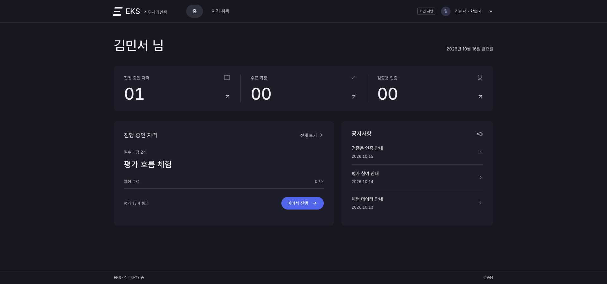
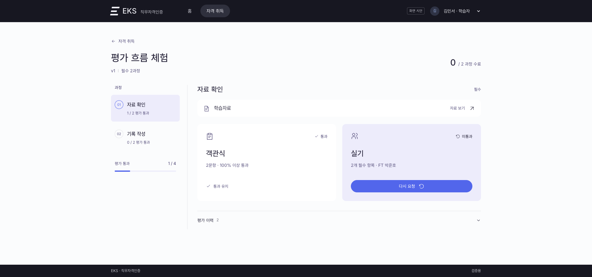
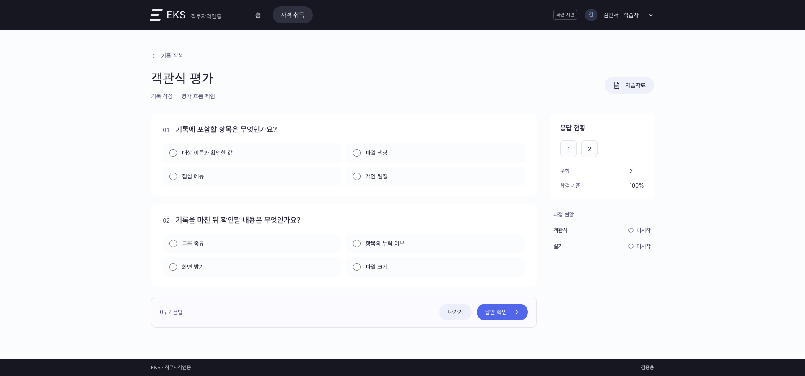
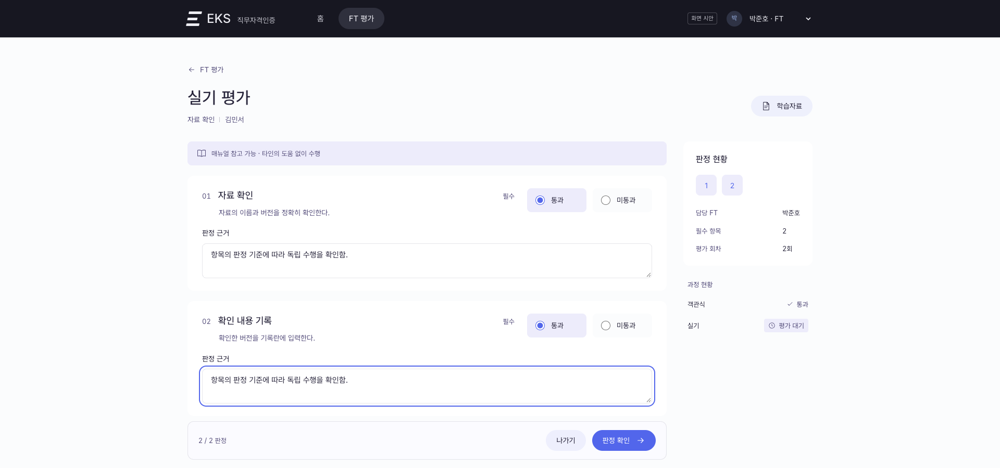
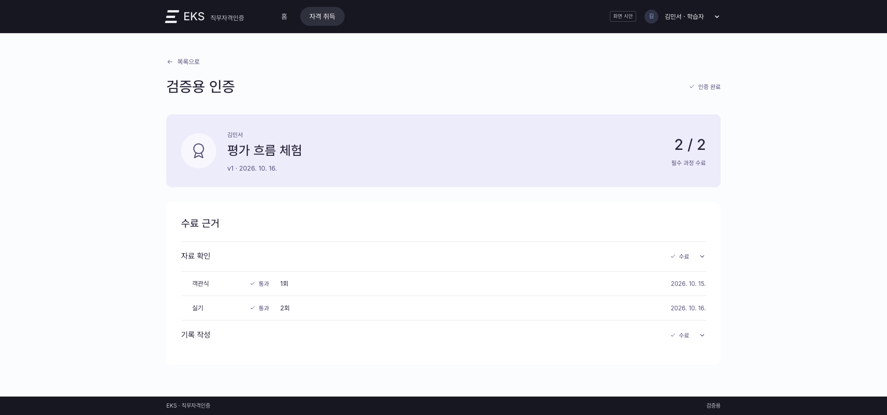
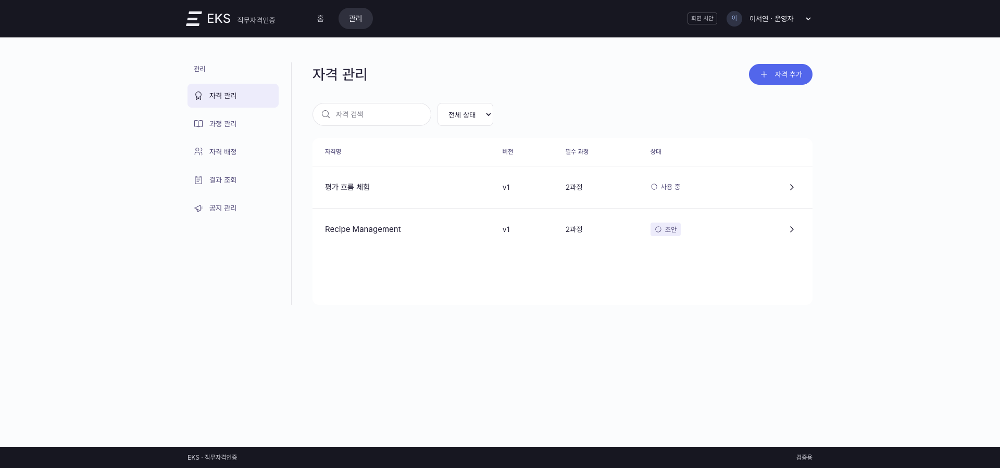

# EKS 직무자격인증 프런트엔드 UX 설계안

## 2026-10-24 균형형 자격 히어로·인증Set 학습 탭 통합

사용자는 균형형160px·학습범위 최초 선택을 확정했다. 자격 히어로는 블루그레이/네이비/회색 테두리를 유지하고 데스크톱 최소160px·내부24px의 좌우 배치로 구성한다. 왼쪽 제목24px/600·메타13px·자격 정보, 오른쪽 수료/통과20px/600·분모14px·목표일16px/500의 세 열과 인증 계획 보기다. 학습 목록 링크는 제거하며 설명/영문명/기간/조건의 기본 접힘·수동 펼침/재조회 보존·취득/효력/인증서·Hold/제외 안내는 유지한다. 아래 인증Set 작업면과32px(모바일24px) 간격을 둔다. 이전112/144/650px 상한을 해제하며 긴 이름/수동 펼침은 자연스럽게 확장한다.

인증Set 히어로에서 목표 제목/본문/전체 보기를 제거하고 일정·목표 수정을 일정 수정으로 변경한다. 기존 목표 문자열과 선택 입력/계획·관리자 조회는 보존한다. 일정은 전체 날짜의 학습 기간 / 평가 예정일을 한 줄로 배열한다. 라벨13px·날짜14px/500·평가일 인디고/600과 구분선으로 구별하며 미정은 미설정, 좁은 화면은 그룹별 줄바꿈이다. 날짜를 이용한 새 진행/기한 판정은 추가하지 않는다.

요약 아래16px에 공통 CompactTabs를 재사용한 학습범위/학습자료 가로 탭과 개수를 제공한다. 학습범위가 최초 기본이며 활성 패널의 중복 제목은 생략한다. 범위는 종류/이름/필수·처음3개/전체 보기를 유지하고 펼친 목록은 데스크톱480px 내부 스크롤/키보드 포커스, 모바일 페이지 스크롤로 제공한다. 자료는 기존 유형별 세로 탭/단일 본문/복사·열기다. 비활성 패널을 제거해 숨겨진 자료의 크기 변화/스크롤 관찰을 피하고 이전 읽기 위치는 제거 직전에 저장, 복귀 시 복원한다. 자료 복사 중 이탈 후 늦은 결과도 무시한다.

기존 계정/배정/인증Set 메모리에 contentTab: scope|materials(기본scope)을 추가한다. 같은 계정에서 인증Set·학습/평가 왕복과 데이터 재조회는 마지막 가로 탭·범위 펼침·자료/위치를 유지하며 새 인증Set·페이지 새로고침/계정 변경은 초기화한다. API/JSON/학습 이력·목표 정책·공통 탭/자료 조회 입력 계약은 바꾸지 않는다. 좌우/Home/End·현재 탭/패널 연결·모바일44px와 대비/초점을 유지한다. Node24.22.0 임시 JSON 전체 Playwright186/186(4.3분)·보완 후 관련15/15·마지막 안내 수정 후6/6·최종 TypeScript/Vite·14파일 Prettier·diff를 통과했다. 모바일 탭36px를44px로 보완한 뒤 키보드·패널/선택/데스크톱·모바일 위치 복원·자료 삭제/계정·목표 미노출/보존·복사 거부/늦은 결과와 기존 업무를 확인했다. 네 폭의 가로 넘침/초점 가림 없음·44px·글자4.69:1/조작3.41:1/강조선6.19:1/초점5.86:1 이상이다. 표준 계획은 자격160px·인증Set94.84px·자료 본문 시작519.14px다. 동일 목표 없는 표준 자료의 본문 시작은1920/1440px 571→515px, 768px 898→819px, 390px 926→819px로 이동했다. 범위/자료 캡처와 실제 검증은 docs/HANDOVER.md·`/private/tmp/eks-learning-tabs-final/frontend/test-results/`에 기록했다. 실행 화면/최종 빌드에 반영했고 API 재기동 없이 업무46/조직4/maintenance·서버/shared와 기존 미커밋을 보존했다. 아래 압축 상한·목표 노출과 범위/자료 동시 배치는 이전 구현 이력이다.

## 2026-10-24 1920×900 학습 상단 요약 압축

사용자는 블루그레이·핵심 요약형을 선택했다. 자격 요약은 `--surface-tint`(#f6f9fc)/`--ink`(#0d253d)/`--line`(#e3e8ee)1px로 구분하며 왼쪽 강조선은 제거한다. 학습 브레드크럼을 없애고 첫 행에 자격명24px/600·버전/상태·학습 목록/자격 정보, 둘째 행에 수료/통과 수·목표일과 인증 계획 보기를 한 줄로 정렬한다. 수치의 큰 글자와 별도 진행 막대는 제거한다. 설명·영문명·인증기간·취득 조건은 기본 접힘의 자격 정보에서 원문 전체를 읽는다. 버튼은 aria-expanded/controls를 제공하고 키보드로 조작한다. 같은 배정의 인증Set 전환·재조회는 수동 펼침을 보존하고 최초 진입·계정/배정 변경은 접는다. 취득 효력·날짜·인증서 행과 Hold/제외 안내는 유지한다. 평가 브레드크럼은 유지한다.

인증Set 요약은 흰 배경/인디고 왼쪽4px를 유지한다. 첫 행에 이름18px·버전/상태13px와 수정/평가 이동을 모으고 별도의 선택 인증Set 행은 제거한다. 1024px 이상은 목표/개인 일정 두 열, 그 미만은 세로로 정렬한다. 목표는15px/1.65·기본2줄/전체 보기이며 빈 목표는 생략한다. 공통 `ExpandableText`의 선택적 `lines?: number`는 기본3이다. CSS 생략과 넘침 판정에 같은 줄 수를 사용해3줄 목표도2줄 접힘에서 전체 보기를 제공한다. 목표 펼침은 기존 계정/배정/인증Set 메모리를 사용한다. 인증Set 내부12px 16px/행8px, 학습 구역 간12px이며 모바일 조작44px·긴 제목의 자연 확장을 유지한다.

표준1920×900에서 자격112px/인증Set144px/자료 본문 시작650px 이내를 인수 기준으로 삼는다. Node24.22.0 임시 JSON 전체 Playwright184/184(4.2분)·TypeScript/Vite·9파일 Prettier·diff를 통과했다. 목표0/1/2/3줄·전체 보기/펼침 유지·목록/계정·자료/응시와 기존 업무 회귀, 네 폭의 긴 정보·취득/종료/제외/Hold·44px·넘침/초점 비가림을 확인했다. 목표가 있는 계획은 자격106px/인증Set143.69px/자료 본문642.25px로 기준을 충족했다. 같은 목표 없는 표준 자료의 본문 시작은1920/1440px 775→571px, 768px 1,136→898px, 390px 1,182→926px다. 실제 글자 대비4.69:1/조작 경계3.41:1/강조선6.19:1/초점5.86:1 이상이다. 측정·캡처와 상세 근거는 docs/HANDOVER.md 및 `/private/tmp/eks-compact-learning-final/frontend/test-results/`를 따른다. 실행 화면/빌드에 반영했고 업무46/조직4/maintenance 해시·서버/shared를 보존했으며 API 재기동은 없다. API/JSON/계산·목표 선택 입력·자료 유형/복사/읽기 위치·평가 이동은 유지한다. 아래 이전 화이트 자격 히어로·기본3줄 목표 설명은 이번 정책으로 대체한다.

## 2026-10-24 자료 유형 탭·인증Set 히어로·선택 학습목표

자료별 세로 탭은 등록 순서를 유지하며 `직접 작성`, `EDM Link`, `Confluence`, `일반 URL`만 표시한다. 같은 유형은 유형 내 순번을 붙인다. 선택 자료명은 본문 제목에서 표시하고, 탭의 `ariaLabel`/툴팁에는 유형·순번·자료명을 제공한다. 공통 `CompactTabs.items`에 선택적 `ariaLabel?: string`을 추가했으며 미지정 시 기존 label을 사용한다. 방향키·Home/End·선택 자료·읽기 위치 보존과 관리자 조회 방식은 유지한다.

외부 자료는 자료명 → 설명 → 원본 전체 URL → 주소 복사/자료 열기 순서다. URL은 직접 선택할 수 있으며 긴 주소는 줄바꿈한다. 유효한 HTTP(S)만 복사·새 창 열기를 제공하고 `noopener noreferrer`를 적용한다. 빈 주소·잘못된 주소는 안내만 제공한다. 복사는 클릭으로만 실행하고 성공/실패를 status로 알린다. 실패 시 직접 복사 안내, 진행 중 중복 클릭 방지와 자료·인증Set·계정 변경/이탈 이후 늦은 결과 무시를 적용한다.

선택 인증Set 본문 상단은 화이트·네이비·회색1px/왼쪽 인디고4px 히어로다. 이름18px·버전/상태/학습 시작–완료·평가 예정13px와 일정·목표 수정/평가 이동을 모은다. 일정은 개인 계획의 해당 인증Set 값을 사용한다. 입력된 목표만15px/1.65·세 줄/전체 보기로 표시하며 빈 목표는 제목·빈 패널 없이 생략한다. 학습 범위와 자료는 그 아래에 놓고 평가 화면에는 이 히어로를 렌더링하지 않는다.

계획 일정 단계는 최종 확인을 주 행동, 학습 목표 입력(선택)을 보조 행동으로 제공한다. `학습 목표(선택)` 단계는 방문·입력 모두 선택이다. 프런트 필수 검사와 공유 `planErrors`의 빈 목표 검사를 제거해 신규 확정·확정 계획의 목표 삭제를 허용한다. 빈 값은 기존 goal 문자열로 전달하며 API·JSON 구조는 변경하지 않는다. 날짜 필수/순서·2,000자·변경 사유·명시적 확정 계획 저장·실패/충돌 복구는 유지한다. 최종 확인과 관리자 조회도 빈 목표를 생략하고, 추가(선택)/수정 버튼으로 해당 입력에 초점을 맞춘다. 학습 범위의 필수 여부는 목표 입력과 독립적이다.

검증: Node24.22.0 임시 JSON 서버188/188·Playwright182/182(4.1분)·TypeScript/Vite·18파일 Prettier·diff 통과. 목표 단계 미방문/공백/혼합·확정 후 추가/삭제·필수 날짜/2,000자·실패/충돌·유형 중복/긴 URL·복사 성공/거부/늦은 결과·새 창·자료100개/읽기 위치/계정과 기존 흐름을 확인했다. 1920/1440/768/390px 캡처의 가로 넘침 없음·모바일44px·글자 최소4.95:1/조작3.41:1/강조선과 초점6.19:1을 확인했다. 표준 자료의 데스크톱 본문 시작775px/페이지1,478px, 768px는1,136/4,016px, 390px는1,182/4,950px다. 실제 API와 Vite/빌드 화면에 반영했고 업무46/조직4/maintenance 해시는 그대로다. 상세 근거는 docs/HANDOVER.md와 `/private/tmp/eks-optional-goals-final/frontend/test-results/`다. 아래 이전 필수 목표 문구와 자료명 탭 설명은 이번 정책으로 대체한다.

## 2026-10-24 학습 히어로 색상 후속 선택

사용자가 화이트·인디고 라인을 선택했다. 학습 히어로는 배경 `var(--surface)`/본문 `var(--ink)`, 회색 `var(--line)` 외곽선1px·왼쪽 `var(--primary)` 강조선4px다. 링크는 `var(--link)`, 진행 막대는 `var(--progress)`/바탕 `var(--progress-track)`, 내부 구분선은 `var(--line)`을 사용한다. 모바일에도 왼쪽4px를 유지한다. 원래 배치·여백·Pretendard·크기·접기/펼치기와 업무 인터페이스는 유지하며 아래 최초 크림 색상 결정을 대체한다.

Node24.22.0 임시 JSON 관련 Playwright5/5·TypeScript/Vite·코드3파일 Prettier·diff 통과. 네 폭1920/1440/768/390px 캡처·정렬·가로 넘침 없음·키보드 접기/초점을 검토했다. 실제 배경 기준 글자 최소4.95:1·조작 경계 최소3.41:1·강조선과 초점6.19:1이다. 근거는 `/private/tmp/eks-hero-white-{browser,build,format}.log`와 `/private/tmp/eks-hero-white-results/`의 캡처/`palette-audit.json`이다. API·컴포넌트 인터페이스·데이터 변경은 없다.

## 2026-10-24 홈 계획 표시·학습·평가 목적 분리

홈 계획 카드는 현재 소속·Lv1의 미완료 요청 중 `planningOptions.canComplete !== true`인 요청만 집계한다. 완료 확인만 남았거나 추가 계획 대상이 없는 요청은 제외하고, 남은 요청의 수와 가장 이른 기한을 표시한다. 준비 대기·진행 제한·조회 정보 누락은 `요청 상태 확인`이다. 작성 완료 후 `다음 할 일`에는 `요청 전체 완료 확인`을 표시한다. 단순 조회는 요청 완료 기록을 만들지 않는다. 기존 Hold·비활성 소속 제외, 갱신 시 자격 선택 유지와 제거 시 첫 자격/초점 복귀를 보존한다.

| 메뉴 | 목록 주소 | 상세·이동 |
| --- | --- | --- |
| 내 계획 | `/plans` | 기존 작성·확정·요청 전체 완료 |
| 학습 | `/qualifications` | `/qualifications/:id?course=인증SetID` |
| 평가 | `/qualifications?stage=assessment` | 같은 상세 주소에 `stage=assessment` |
| 보유 자격 | `/qualifications?filter=certified` | 기존 인증서·효력 조회 |

학습/평가를 전환하거나 인증Set을 바꿔도 현재 대상과 목적을 유지한다. 실제 링크와 `aria-current`로 현재 메뉴를 표시하고 목록 복귀는 별도로 제공한다. 홈과 계획 완료는 학습, 평가 결과·수료증의 돌아가기는 평가로 연결한다. 평가 목록은 평가 통과 수·남은 평가를 보여준다.

학습은 화이트 `#ffffff`·네이비 `#0d253d`, 회색 `#e3e8ee` 외곽선1px·왼쪽 인디고 `#533afd` 강조선4px의 히어로에 자격명·확정 버전·상태·설명과 수료/통과/목표일을 통합한다. 설명과 목표는 기본 세 줄과 전체 보기를 제공한다. 영문명·인증기간·취득 조건은 `자격 정보` 접힘 영역이다. Hold·검증 제외는 항상 보이며 단순히 현재 필수가 아니어서 표시하던 포괄적 이전 기준 안내는 제거한다. 1280px 이상 인증Set 목록240px/본문, 그 미만 접는 선택기를 사용한다. 목표·일정은 짧은 행, 학습 범위는 종류/이름/필수와 처음3개·전체 보기다. 자료가 없으면 한 줄로 안내한다.

전용 `LearningMaterialReader` 입력은 `materials: LearningMaterial[]`, `contextKey: string`(계정/배정/인증Set)이며 업무 저장 이벤트가 없다. 첫 직접 작성 자료(없으면 첫 자료)를 선택하고 등록 순서를 유지한다. 1024px 이상 자료 목록200px/단일 본문 각각 최대 `min(60dvh,640px)` 스크롤, 그 미만 접는 목록/페이지 스크롤로 읽는다. 직접 작성 원문·줄바꿈을 보존하고 외부 URL은 새 창·noopener noreferrer로 연다. 자료 선택과 자료별 위치는 브라우저 메모리만 사용한다. 탭 왕복·재조회에 유지하고 삭제 시 안전하게 대체하며 계정 전환은 다른 화면에서도 즉시 초기화한다. 관리자 `CourseMaterials`의 다중 펼침은 바꾸지 않는다.

평가 선택에는 자격명·인증Set명/버전·상태·필요한 제한 안내와 유형별 문항 수/합격 기준/응시 행동만 제공한다. 자격 설명·목표·일정·자료는 렌더링하지 않는다. 이력은 기본 접힘, 수료증은 짧은 상태 행이다. 응시 화면의 자료 모달은 `학습으로 이동`으로 대체하며 기존 답안 flush·실패/충돌 시 재시도/명시적 이탈 확인을 거친다. 저장된 답안·동일 회차·마지막 문항을 유지한다. 평가 선택만으로 응시를 만들지 않고 채점·선행 조건·최종 제출 정책을 유지한다.

경로 생성/판정은 `learner-navigation.ts`, UI 메모리는 `useLearnerMemory`에서 공통 처리한다. `LearnerNav`는 선택적인 `assignmentId`/`courseId`를 받아 같은 대상의 링크를 만든다. `ExpandableText`는 text/subject와 선택적인 expanded 모델을 받는다. API·JSON·업무 완료·학습 이력 스키마와 기존 공통 접기 인터페이스는 그대로다. Pretendard 제목24/600·구역18/600·항목16/500·본문15/1.65·UI14·메타13, 기본40/모바일44px를 사용한다.

참고: [USWDS Summary box](https://designsystem.digital.gov/components/summary-box/)의 핵심 정보 우선 배치, [Moodle Course index](https://docs.moodle.org/405/en/Course_index)의 현재 위치 유지, [Carbon Structured list](https://www.carbondesignsystem.com/building-blocks/core/components/structured-list/guidelines)의 간결한 행, [GOV.UK Service navigation](https://design-system.service.gov.uk/components/service-navigation/)의 현재 메뉴 표시를 적용했다. 새 UI 라이브러리는 추가하지 않았다.

검증: Node24.22.0 임시 JSON 전체 서버185/185·전체 Playwright176/176(3.9분), TypeScript/Vite·변경 코드29파일 Prettier·diff 검사 통과. 자료0/1/5/100·학습 항목100·인증Set100·긴 원문·외부 링크·삭제/재조회·계정 전환·Hold/제외/종료·지식 선행·수료/인증을 확인했다. 홈 카드 제거 후 요청 완료 기록 불변과 별도 완료, 직접 URL/뒤로/앞으로/새로고침, 저장 중 이동·실패/충돌/응답 유실·동일 회차·마지막 문항을 검증했다. 모바일 읽기 위치는 빠른 자료 선택 직후 기록 누락과 라우터 스크롤 초기화 경합을 보완하고10회 연속 왕복을 통과했다. 첫 전체 실행174/176의 구 구조 기대 시험과 모바일 경합을 수정한 뒤 최종 전체를 통과했다. 모바일 평가의 고정 높이 제거 후 관련 화면/흐름/접근성14/14와 빌드를 추가 확인했다.

표준 비교 표본은 같은 자격 설명2줄·학습 항목10개·직접 작성 자료5개(각35개 반복 문단)이며 첫 자료만 표시했다. 네 폭에서 가로 넘침 없음·본문15px/1.65·제목24px/600·Pretendard·실제 글자 대비4.5:1 이상/조작 경계3:1 이상·모바일 조작44px 이상을 확인했다. 데스크톱 본문은 내부 스크롤, 모바일은 원문 전체의 페이지 스크롤이므로 전체 높이를 동일하게 제한하지 않는다.

| 폭 | 페이지 높이 전→후 | 자료 본문 시작 전→후 |
| --- | --- | --- |
| 1920 | 5,096→1,440px | 1,621→737px |
| 1440 | 5,096→1,440px | 1,621→737px |
| 768 | 5,219→4,082px | 1,736→1,202px |
| 390 | 6,518→5,016px | 2,111→1,247px |

전후 캡처/측정은 `/private/tmp/eks-learning-before-captures/`, `/private/tmp/eks-learning-visual-final-results/`, 전체 회귀는 `/private/tmp/eks-learning-final.log`, 서버는 `/private/tmp/eks-learning-server.log`다. 아래 날짜가 오래된 자격 상세/다중 자료 안내는 구현 이력이며 이 구성을 우선한다.

## 2026-10-24 계획 요청 밀도·전체 표·최종 확인

계획 요청 현황은 이름 / 소속 / 요청 가능 / 최근 요청 상태 / 최근 요청 기한 / 상세의 개인별 한 줄 표다. 제목·요청 현황 필터·계획 수립 요청을 같은 도구 행에 두며 하단 자격별 취득 진행의 필터·페이지 설정과 분리한다. 요청은 생성 시각 내림차순·동률 ID 오름차순으로 대표를 선택하고, 이전 미완료 요청 수와 기한 경과는 짧게 표시한다. 상세 대화상자에서 전체 조직 경로·준비 건수·요청 안내/당시 기준·개인 계획을 조회하며 닫으면 호출 초점과 스크롤을 복원한다.

요청 모달은 최대960px, 1024px 이상에서 대상자 목록/기한·안내문 두 열, 그 미만은 한 열이다. 이름·조직 검색과 전체 선택 수를 표시하고 검색 밖 선택도 유지한다. 이름·짧은 요청 가능 상태·소속만 한 줄로 제공하며 체크박스의 접근성 설명에는 전체 조직 경로와 상태를 포함한다. 목록은 내부 스크롤, 데스크톱40px/모바일44px 이상이다. 실패 시 입력·선택을 보존하고 기존 중복 요청 방지와 서버 판정을 사용한다. 계정/팀/관리 권한 변경 시 이전 인물 자료를 지운다.

모든 일반 표는 Pretendard14px·40px 기본 밀도로 고정한다. 모바일 조작은44px 이상이며 일반 표의 긴 내용/매트릭스 복수 상태는 필요한 만큼 확장한다. 밀도 선택과 density 모델/속성/이벤트는 일반 목록·대시보드에서 제거한다. 기존 로컬 저장 키와 정렬·페이지 크기는 유지하고 과거 roomy 값만 무시한다. 다음 설정 저장에는 밀도 필드를 포함하지 않는다. Tabulator의40px·가상 렌더링/편집은 유지한다.

최종 확인은 계획 요약 → 인증Set 일정·목표 → 완료 안내 → 확정 계획 수정 사유/저장 → 요청 기준(기본 접힘) → 저장 피드백·최종 행동 순서다. 요청 기준은14px의 얇은 접힘 구역으로 두고 최초 진입/계획·계정 변경/재로드 시 접는다. 같은 계획의 수동 펼침은 자동 저장·재조회·단계 왕복에서 유지하며 인증Set의 기본 펼침과 독립적이다. 조직 기준 변경·확정 차단·저장 실패·충돌은 접힌 구역 밖에서 표시한다. API·공유 계약·JSON·업무 정책 변경은 없다.

검증: 1920/1440/768/390px에서 한 줄 표·내부 스크롤·40px 기본/모바일44px 조작·최소14명/12명 노출·검색 밖 선택·실패 재시도·상세 초점 복귀·독립 접힘을 확인했다. TypeScript/Vite와 전체167개 브라우저 시나리오를 검증했다(분리 사본166/167 후 시험용 Git 파일 보완으로 접근 차단1/1 재통과). 별도 홈·학습 개편이 동시에 진행되어 이번 변경과 착수 기준을 분리한 임시 사본을 사용했으며 병행 개편의 전체 회귀를 뜻하지 않는다. 실행 근거와 기존 실패 구분은 두 인수인계의 같은 날짜 기록을 따른다.

## 관리 탐색 — 2026-10-24 현재 기준

인증 업무 관리는 아래 순서의 네 그룹으로 구성한다. 메뉴는 평면 링크이며 그룹별 접기와 추가 탐색 단계는 없다. 기존 URL·메뉴 ID·권한·화면 설정 저장 키는 유지한다.

| 그룹 | 메뉴 순서 |
| --- | --- |
| 현황 조회 | 인증 현황 |
| 인증 운영 | 취득 대상자 상태 → 계획 요청·진행 → 평가·수료 결과 → 보유 자격 관리 |
| 자격 기준 설정 | 팀 자격 설정 → 조직 필수 자격 설정 → 인증Set 설정 → 기준 일괄 편집 |
| 팀 소통 | 팀 공지 관리 |

팀 자격 설정은 팀에서 운영할 자격 구성·기간·적용 버전, 조직 필수 자격 설정은 적용된 팀 자격 중 해당 조직의 필수 선택이다. 취득 대상자 상태는 인원 단위 Hold·해제, 보유 자격 관리는 이미 취득한 자격의 효력·기간·이력을 다룬다. 인증 현황은 집계·차트, 평가·수료 결과는 개인별 회차와 근거를 조회한다.

팀 관리자와 선택 Lv1 운영자는 전체 10개 메뉴를 사용한다. 세부 조직 관리자는 인증 현황·취득 대상자 상태·조직 필수 자격 설정만 표시하며 빈 그룹을 숨긴다. 시스템 공통 기본자격·조직 구조·사용자 관리는 별도 시스템 운영에 둔다.

2026-10-24 사용자 요청으로 평가 기준 검증의 메뉴·비교 기록 화면·프로세스 안내·시스템 조회 탭을 제거했다. 이전 `/admin/comparisons` 및 상세 링크는 같은 관리 조직의 인증 현황으로 연결하고 기존 접근 권한을 적용한다. 관련 조회·작성·확정·정정 API와 workspace 비교 자료 응답도 종료했다. 과거 저장 자료·감사 이력·백업 호환만 유지하며 평가·수료·인증 업무는 변경하지 않는다.

사이드바는 192px·Pretendard 메뉴14px/그룹13px·그룹 간16px·평면 선택 표시를 사용한다. 1024px 이하에서는 단일 열 그룹 목록을 접어 두고 현재 메뉴를 표시한다. 메뉴 조작은 데스크톱40px/모바일44px 이상, Escape 취소는 열기 버튼에 초점을 돌려준다. 이동 취소 시 메뉴와 입력은 유지한다.

조직 상세는 조직 요약 → 필수 자격(기본 펼침·선택 사항) → 조직 정보(기본 접힘) → 조직 설정 변경 확인 → 세부 조직 관리자(기본 접힘) 순서다. 보조 구역을 접어도 컴포넌트와 입력은 유지하고 미저장 변경을 제목에 표시한다. 조직 정보·필수 목록 저장과 관리자 지정 저장은 기존처럼 분리한다. 승인된 조직 전환 후에만 접힘을 초기화하며 오류 구역은 펼쳐 확인한다.

계획 요청·진행은 요청 현황(요청 가능 상태·요청별 계획·기한/단계)과 자격별 취득 진행(배정·인증Set 수료·취득 상태·검증 제외)으로 분리한다. 각 필터와 목록 도구는 해당 구역에만 적용한다. 필수·팀 적용 자격이 없어도 정상 대상자에게 요청 가능하며, 대상자 Hold와 개인 보유 효력 변경은 전용 화면에서 처리한다.

2026-10-23 검증: Node24.19.0 임시 JSON 관련15/15·전체 서버186/186·전체 Playwright161/161·TypeScript/Vite·프런트33파일 형식·diff 검사 통과. 네 역할과1920/1440/768/390px에서 메뉴·초점·입력/실패/권한 회수·필터 독립과 기존 평가/인증/차트를 확인하고 대표 캡처를 검토했다. 실행 Vite 반영과 실제 업무/조직 해시 보존을 확인했으며 서버 재기동·업무 변경·커밋·푸시는 하지 않았다. 근거는 두 인수인계의 같은 날짜 기록을 따른다.

2026-10-24 종료 기능 검증: 임시 JSON 전체 서버185/185·Playwright162/162·TypeScript/Vite·형식 검사 통과. 메뉴·시스템 탭 제거, 이전 링크의 조직/권한 보존, 네 역할·네 화면 폭·기존 업무 회귀와 대표 캡처를 확인했다. 실제 서버에 반영했고 실행 중 추가된 사용자 기록도 보존했다. 세부 근거는 두 인수인계의 같은 날짜 기록을 따른다.

## 2026-10-23 계획 최종 확인 정돈

2026-10-24 후속 개선을 적용한 최종 확인은 계획 요약 → 인증Set별 일정/목표 → 완료 안내 → 확정 계획 변경 사유/저장 → 요청 기준(기본 접힘) → 저장 피드백·최종 행동 순서다. 요약은 자격명·버전·목표 인증일·필수 인증Set 수·작성 기한을 라벨/값으로 정렬하고 설명을 전체 폭에 표시한다. 목표 인증일은 기존 인디고로 강조한다. 이 단계에서는 기존 상단 자격 문단을 숨겨 중복을 제거하며 다른 단계의 구성은 유지한다. 현재 소속과 요청 당시 필수 자격은 마지막 접힘 구역에서 조회하며 조직 기준 변경 안내는 접힘 밖에 표시한다.

인증Set은 기존 CollapsibleSection의 open 모델을 재사용하여 모두 펼쳐 시작한다. 머리글에 순번·이름·정확한 버전·평가 예정일을 표시하고 본문에 학습 시작/완료/평가 예정일과 학습 목표를 구분한다. ID별 펼침은 같은 계획의 수정·재조회에서 유지하고 계획/계정 변경 시 초기화한다. 목표 인증일 수정·각 인증Set 일정 수정/학습 목표 수정은 기존 단계의 해당 입력에 초점을 맞추며 값을 유지한다. 공통 컴포넌트 인터페이스는 변경하지 않는다.

최종 단계의 기존 ActionBar에 저장 상태와 계획 완료 버튼을 함께 배치한다. 결재 생략·완료 후 학습/평가 이동·요청 전체 완료는 내 계획에서 별도로 한다는 안내를 본문 끝에 표시한다. 저장/완료 오류가 있으면 하단 고정을 해제해 검토 내용을 가리지 않으며 완료 오류는 버튼 옆에 표시하고 초점을 옮긴다. 확정 계획은 같은 구조로 조회하며 변경 사유와 명시적 일정/목표 저장, 학습/평가 이동을 유지한다. API·저장 스키마·자동 저장·검증·충돌/실패 복구·운영 제한은 변경하지 않는다.

Pretendard·페이지24/600·구역18/600·항목16/500·설명/목표15/1.65·UI14·라벨13px, 흰 작업면과 옅은 보조 배경·얇은 구분선을 사용한다. 데스크톱 요약2열/일정3열, 768px 이하1열과44px 조작 영역을 적용하며 긴 이름/설명/목표를 생략하지 않는다. 전용 plan-review.css로 기존 다른 화면의 레이아웃에 영향을 주지 않는다.

2026-10-23 검증: 임시 JSON 기반 최종 확인8건과 기존 계획/요청/업무/공통 UI 회귀를 포함한 Playwright40/40, 서버/프런트 TypeScript·Vite 빌드·포맷·diff 검사 통과. 1/5/20개 인증Set·긴 정보·누락 차단·확정/버전·필수 없음/기준 변경/Hold·키보드 초점·입력/펼침 보존·저장 실패/충돌·완료 응답 유실/재조회 실패·단일 배정을 확인했다. 1920/1440/768/390px 캡처와 글자 위계·대비4.5 이상·44px·넘침·고정 실행 영역의 초점 비가림을 검사하고 대표 캡처를 검토했다. 산출물은 `/private/tmp/eks-plan-review-final/`와 같은 이름의 `.log`다.

## 2026-10-23 내 알림 정돈과 표시 기반 읽음

기존 `내용 확인` 버튼을 누를 때만 읽음 처리하던 정책을 대체한다. 내 알림은 최신순의 독립적인 접기·펼치기 구역이다. 진입 시 미읽음은 펼치고 읽음은 접는다. 제목·읽음 상태·KST 일시·화살표를 머리글에 두고 본문 아래 `관련 업무로 이동`에서 기존 목적지로 이동한다. 전체/미읽음 건수와 필터를 상단에 배치하며 전체 0건과 미읽음 결과 0건을 구분한다.

공통 `CollapsibleSection`은 기존 `title`, 본문/summary 슬롯에 선택적 `open: boolean` 모델과 `update:open(boolean)` 이벤트를 추가한다. 모델 미지정 시 내부 기본값 `true`를 사용한다. 팀 자격 상세의 초기 펼침·독립 조작·v-show 입력 보존과 버전 이력 기본 접힘은 유지한다.

알림 본문을 `IntersectionObserver`로 관찰하고 활성 문서·펼침·뷰포트의 실제 양수 면적 겹침을 확인한 뒤 기존 `store.command` 읽음 API를 호출한다. 대기 요청을 실행하기 직전에도 노출을 재검사한다. 화면 밖·접힌 본문·백그라운드 문서는 자동 읽음 대상이 아니다. 알림 ID별 중복 요청을 공유하고 순차 처리하며 서버 반영과 재조회가 성공해야 화면 읽음 상태와 건수가 갱신된다. 실패한 행은 본문·오류·`읽음 처리 재시도`를 유지하고 자동 재시도를 반복하지 않는다. 업무 이동은 같은 진행 중 요청을 기다리며 실패하면 현재 화면에 남는다. 응답 유실/재조회 실패 재시도는 기존 명령의 멱등 키/확인된 결과를 재사용한다.

읽음 상태와 펼침 상태를 분리한다. 자동 읽음 이후에도 본문·현재 미읽음 필터 목록은 그대로 유지하며 필터에는 “이 화면에서 확인한 알림은 목록에 유지됩니다.”를 표시한다. 필터 재선택·화면 재진입 시 최신 읽음 상태로 목록과 초기 펼침을 계산한다. 일반 갱신은 개별 펼침을 보존하고 새 미읽음은 펼쳐 추가한다. 계정 변경/이탈은 관찰·대기 요청을 정리하고 이전 작업의 늦은 결과나 업무 이동을 적용하지 않는다. API·알림 스키마·업무 완료 정책은 변경하지 않는다.

Pretendard와 기존 토큰으로 제목 24px/600, 알림 제목 16px/500, 본문 15px/1.65, 상태·일시·도움말 13px을 사용한다. 흰 본문·옅은 머리글·얇은 구분선과 작은 인디고 미읽음 표시를 적용한다. 긴 제목/본문은 줄바꿈을 보존하고 768px 이하에서는 메타·행동을 세로로 배치하며 조작 높이 44px 이상을 확보한다.

2026-10-23 검증 완료: 임시 JSON Playwright28/28(알림13·기존 업무/알림 UI3·팀 자격4·공통 UI8), TypeScript/Vite 빌드·포맷·diff 검사 통과. 키보드·노출/접힘/화면 밖·백그라운드 visibility 이벤트 모의·순차/중복 요청·실패/응답 유실/재조회 실패·업무 이동·즉시 재진입·필터 보존/초기화·새 알림/계정 전환을 확인했다. 1920/1440/768/390px 긴 내용과 두 빈 상태 캡처, 글자 크기/두께·대비4.5 이상·초점·44px 조작·가로 넘침을 검사하고 주요 캡처를 검토했다. 산출물은 `/private/tmp/eks-notifications-final/`와 같은 이름의 `.log`다.

## 2026-10-23 홈 진행 중 자격 캐러셀

후속 요청으로 홈과 `내 계획`의 독립된 `내 소속 필수 자격` 영역을 제거했다. 내 계획의 `취득할 자격` 드롭다운은 요청 당시 필수 자격을 `[필수]`로 구분하며, 취득·확정한 자격은 기존 요청 현황에서 확인한다. 조직 필수 정책과 요청 전체 완료 검사는 유지한다.

학습자 홈 본문 왼쪽 첫 영역에 진행 중 자격을 한 번에 하나씩 표시한다. 자격명·배정 당시 버전·설명 최대 두 줄·목표 인증일·인증Set 수료/평가 통과 현황을 제공하며 진행 막대는 인증Set 수료율이다. `상세정보 보기`는 해당 배정의 기존 자격 상세로, `전체 보기`는 자격 목록으로 연결한다. 오른쪽 공지와 관리자/운영자 홈은 유지한다.

외부 의존성 없는 가로 스크롤 스냅과 이전/다음·현재 번호/전체 개수·모바일 스와이프·좌우 방향키를 사용한다. 자동 재생/순환 없이 1항목이면 조작을 숨기고 0항목이면 기존 빈 상태와 계획/인증 링크를 제공한다. 현재 카드만 접근성 트리/키보드에 노출하고 44px 조작 영역·모션 감소·Pretendard·기존 평면/글자 토큰을 적용한다.

### 후속 승인 — 캐러셀 영역의 색상과 탐색 표시

제목과 `전체 보기`는 기존 흰 배경과 바깥 열 정렬을 유지한다. 카드 본문과 탐색부는 `--tint`(#f0edff) 배경·`--line` 1px 테두리의 한 면으로 묶는다. 모서리는 평면이며 그림자/그라데이션은 추가하지 않는다. 본문 여백은24px, 767px 이하에서16px이다. 기존 정보 열·행동 버튼 정렬·타이포그래피와 공지 배치를 유지한다.

탐색부는 같은 면 안에서 얇은 구분선으로 나눈다. 흰 버튼에 인디고 화살표와 `이전`/`다음` 글자를 함께 표시하며 현재 번호는 인디고·600으로 강조한다. 조작 높이44px 이상, 접근성 이름 `이전 항목`/`다음 항목`·현재 위치 안내는 유지한다. 틴트 위 작은 라벨은 `--ink-secondary`로 조정해 글자 대비4.5:1 이상을 확보한다. 계획/자격 카드와 빈 상태 모두 같은 인디고 배경·테두리·반응형 여백을 사용한다. 1항목은 탐색부를 숨기고 0항목은 기존 안내와 계획/인증 링크를 같은 색 면 안에 표시한다. 빈 상태 글자도 `--ink-secondary`로 대비를 확보한다. 이는 요청 없는 계정도 영역이 구분되어야 한다는 후속 요청을 반영한다. 입력·API·계산·링크·스와이프/방향키/초점·선택 유지·모션 감소는 변경하지 않는다.

검증: 변경 전 반응형2/2·변경 후 관련 홈/계획/히어로 Playwright14/14 및 프런트엔드 타입/Vite 빌드·포맷·diff 검사 통과. 네 화면 폭에서 긴 계획/자격 정보·1항목/빈 상태·기존 제목/열 정렬·공지·44px·글자 대비4.5:1/활성 조작부3:1·키보드 초점·실제 스와이프·선택 유지/모션 감소를 확인하고 대표 캡처를 검토했다. `/private/tmp/eks-carousel-tint-{before,after}*`에 로그/화면을 기록했다.

### 후속 승인 — 첫 항목의 자격 계획 수립

본인의 현재 소속과 Lv1에 해당하며 전체 완료되지 않은 계획 수립 요청이 있으면 `자격 계획 수립` 카드 하나를 맨 앞에 추가한다. 취득 대상자 Hold와 비활성 소속은 제외한다. 자격 배정이 없어도 표시하며 알림 읽음·초안·개별 자격 계획 확정은 표시 여부에 영향을 주지 않는다. 요청의 별도 `계획 수립 완료` 처리 후 제외한다.

미완료 요청 수, 가장 빠른 작성 기한(경과 시 표시), 해당 요청의 서버 계산 현재 단계와 안내문 최대 두 줄을 보여 준다. 안내문이 없으면 계획 수립 안내를 제공한다. `계획 수립하기`는 기한이 가장 빠른 요청의 `/plans?request=요청ID`로 이동한다. 같은 기한은 기존 데이터 순서를 따른다. `자격 준비 대기`·`확인 필요` 단계(단계 정보 누락 포함)는 `요청 상태 확인`으로 표시한다. `추가 계획 대상 없음 · 확인 필요`는 기존 계획 화면에서 전체 완료 확인으로 이어진다.

`HomeView`가 대상 요청을 계산하고 `HomeQualificationCarousel`에 `assignments: Assignment[]`, 선택적 `planningRequests?: PlanningRequest[]`(기본값 빈 배열, 기한순)를 전달한다. 계획 요약 ID는 대표 요청 변경에도 유지되고 자격 ID는 배정별로 유지된다. 홈 진입/계정 변경 시 첫 항목, 갱신 시 선택한 항목 유지(사라지면 남은 첫 항목)로 처리한다. 페이지 개수에는 계획 카드를 1개로 포함하며 조작 접근성 이름은 `이전 항목`·`다음 항목`이다. 상단 진행 중 자격 통계는 배정 수만 계산한다. 기존 할 일·알림·계획 화면·API·저장 스키마와 자격 카드 정보/순서는 유지한다.

검증: 관련 홈/계획 Playwright17개 시나리오(기존11·신규6)와 빈 상태를 보완한 반응형1건 재검증, 프런트엔드 타입 검사·Vite 빌드·포맷·diff 검사 통과. 임시 JSON에서 실제 요청/알림 읽음/초안/개별 확정/전체 완료와 조회 불변을 확인했다. 네 화면 폭의 긴 안내문·빈 상태·공지, 키보드/현재 카드만 탐색·초점 유지/복귀·44px·모션 감소·실제 스와이프 왕복을 검증하고 대표 캡처를 검토했다. 로그/캡처는 `/private/tmp/eks-home-planning-{test,verified,responsive}*`다.

## 팀 자격 상세·인증Set 구성 조회 — 2026-10-23 후속 승인

- 팀 자격 상세는 운영 상태 → 공통 정보 → 팀 설정 → 필수 인증Set의 독립적인 접기·펼치기 구역이다. 주요 구역은 기본 펼침이고 버전 이력은 기본 접힘이다. 접어도 본문과 입력은 보존하며 구역 제목 옆 상태·수정 번호·인증기간·선택 개수는 계속 표시한다. 자격/버전·계정·관리 조직 변경 시 초기 상태로 돌아간다.
- 공통 정보는 자격명·영문명·수정 번호·전체 폭 설명의 라벨/값 그리드, 팀 설정은 인증기간·재인증·알림 입력과 연결된 도움말로 구성한다. 데스크톱 2열/768px 이하 1열, 제목24·구역18·항목16·UI14·라벨13px와 모바일44px 조작 영역을 유지한다. 구분선과 옅은 제목 배경으로 구역을 구분한다.
- 필수 인증Set 행의 체크박스와 `내용 조회` 버튼은 별도 조작이다. 조회는 선택 여부와 관계없이 해당 행의 정확한 버전을 표시하고 검색·선택·미저장 입력을 바꾸지 않는다. 기존 AppDialog 기반 최대960px·본문 스크롤 모달에서 기본정보·학습자료·학습 항목 및 활성 평가별 문항 수/합격 기준만 표시한다. 문항·선택지·정답은 렌더링하지 않는다. 빈 항목·미정 기준·운영 종료/삭제 상태를 안내한다.
- 조회 모달의 입력은 `open: boolean`, `course: Course | null`, 출력은 `update:open`이다. 공통 CollapsibleSection은 제목·요약 슬롯·본문 슬롯을 받고 내부 펼침 상태를 유지한다. API·저장 스키마·권한·저장/상태 변경/공통 정보 재확인 동작은 유지한다. Escape·닫기·호출 버튼 초점 복귀와 문맥 변경 시 모달 닫기를 제공한다.

검증: 관련 Playwright21/21 및 마지막 모달 스크롤 보완 후 신규4/4, Node24.22.0 TypeScript/Vite 빌드 통과. 4해상도에서 긴 정보·빈 구성·이전 버전·종료/삭제·읽기 전용·키보드·입력 보존을 확인하고 캡처를 검토했다. 조회 모달은 재열기 때 본문 최상단으로 돌아가며 본문 끝에서도 제목·닫기·확인이 유지된다. 학습자 상세와의 스타일 충돌을 피하도록 팀 상세 속성 목록에 전용 클래스명을 사용한다.

## 선택적 조직 필수 자격과 요청 전체 완료 — 2026-10-23

이 절은 과거의 필수 미설정 차단·현재 필수 목록 한정 계획 규칙을 대체한다. 조직 필수는 선택 속성이다. 조직 상세에서 선정 완료 체크 없이 검색형 체크 목록을 바로 조작하며 빈 저장이 가능하다. 세부 관리자는 실제 소속 한 곳만 편집한다.

관리자는 대상자·기한·안내문만 지정한다. 필수·신규 가능·작성 중 건수를 구분하며 필수/팀 적용 0개도 발송한다. 학습자는 `취득할 자격`에서 현재 계획 가능한 팀 자격을 바로 선택한다. 요청 당시 필수는 `[필수]`로 표시하며 `계획 시작` 때 요청 포함과 초안 생성을 함께 저장한다. 아래 최신 단일 선택 절차를 따른다. 요청 뒤 필수 추가/해제는 현재 조직 현황만 바꾸며 이번 요청 조건은 유지한다.

자격별 일정·목표 확정 후 별도의 `계획 수립 완료`에서 요청 전체를 검사한다. 최소1개 계획/필수 전체 충족/추가 선택 전체 확정, 준비 대기, 모두 취득·진행 중인 대상 없음 확인을 구분한다. 업무 상태 변경으로 진행 불가인 자격을 대상 없음으로 처리하지 않는다. 실패·충돌 시 선택을 유지하고 재시도·재조회·이동 취소를 제공한다. 완료 화면은 당시 계획/인증/이전 직접 배정 근거를 고정해 표시한다.

Pretendard·평면 행·일반14px·라벨13px·모바일44px를 유지한다. 모바일 토스트의 상하 위치 충돌을 제거해 본문을 가리는 세로 확장을 방지한다. 정적 프로세스 검토는 v13/2026-10-23이다.

2026-10-23 실제 검증: 임시 JSON의 네 역할·1920/1440/768/390px에서 직접 필수 선택/빈 저장, 추가 자격 선택·계획·전체 완료, 저장 실패/충돌·입력 보존·재시작을 확인했다. 전체 서버147/147·Playwright107/107·TypeScript/Vite 빌드 통과. 대표 선택/조직 설정 캡처를 검토했고 기존 업무 흐름 회귀도 통과했다.

## 기본자격·팀 자격·필수 자격 — 2026-10-23

시스템 운영의 `기본자격 관리`는 조직 선택 없이 공통 자격명·영문명·설명과 변경 이력을 관리한다. 목록 검색과 편집 대화상자, 미저장 이동 확인·저장 오류·재조회를 제공한다. 공통 설명이 비어 있으면 보완 필요를 표시한다.

팀의 `팀 자격 설정`는 `기본자격에서 등록 → 팀 설정 → 팀 적용` 순서다. 자유 생성 대신 등록 대화상자를 사용하고 이미 등록된 기본자격은 중복 선택할 수 없다. 공통 정보는 라벨·값, 팀의 인증Set·기간·재인증은 입력 위젯으로 나눈다. 표에서 설정 필요와 적용 여부를 확인한다. 팀 적용 대화상자에서 계보별 버전을 선택하며 영향 조직을 표시한다. 필수 지정된 자격의 적용 해제는 먼저 조직 설정을 바꾸도록 안내한다.

조직 설정은 적용된 자격 중 실제 소속의 필수를 선택한다. 팀 버전 편집은 팀 자격 설정에 모으고 링크로 연결한다. 세부 관리자는 자신의 소속 한 곳만 변경한다. 현재 필수 목록은 최신 공통 정보, 확정된 계획·배정·인증은 당시 정보를 표시한다.

공통 정보가 검토 중 변경되면 팀 입력을 유지하고 최신 정보 확인 후 다시 검토한다. Excel·일괄 관리는 등록된 자격의 설정 수정만 제공하며 공통 필드는 읽기 전용이다. 화면은 기존 작은 Pretendard·평면 표·모바일44px·확인 대화상자·실패 복구를 유지한다. 프로세스 검토는 이번 업무 변경에 따라 v12/2026-10-23으로 갱신한다.

## 현재 UI 기준 — 2026-10-23 전면 개편

루트 [DESIGN.md](../DESIGN.md)의 인디고·네이비·밝은 배경을 업무 UI에 적용한다. 사용자가 승인한 **밝은 작업면·촘촘한 밀도**가 홍보용 큰 제목과 얇은 영문 글꼴보다 우선한다. 후속 승인으로 홈의 개인 현황에만 밝은 다색 SVG 그라데이션을 적용한다. [AGENTS.md](../AGENTS.md)에 따라 Pretendard를 사용한다. 아래 과거 디자인 이력의 크기·색상·카드 배치는 현재 규칙으로 대체한다.

| 역할 | 크기·굵기 |
| --- | --- |
| 페이지 제목·현황 숫자 | 24px·600 / 숫자500 |
| 구역 제목 / 항목 제목 | 18px·600 / 16px·500 |
| 일반 UI·표·메뉴 / 읽기 본문 | 14px·400~500 / 15px·400 |
| 라벨·도움말 / 메타 정보 | 13px / 12px |

일반 줄 높이는1.45, 학습·평가·공지 본문은1.65다. 모바일 입력만16px로 유지하며 조작 영역은44px 이상이다. 표의 기본 한 줄 행은40px로 고정하고, 긴 내용은 행 확장을 허용한다. 기본 입력40px·행동 버튼36~40px·pill 형태를 사용한다.

- 배경 흰색·보조 배경 `#F6F9FC`, 본문 `#0D253D`, 설명 `#61718A`, 주요 행동 `#533AFD`, 선택 배경 `#F0EDFF`다. 입력 경계는 검증 중 선택 배경에서3:1을 충족하도록 계획의 `#8191A6`에서 `#78889E`로 보정했다.
- 성공/Active `#147D57`·`#EDF8F1`, 주의/Hold `#8B5E12`·`#FEF6E6`, 오류/Revoke `#B4233D`·`#FFF1F3`는 업무 상태 확장 토큰이다. 문구·아이콘과 함께 사용한다.
- 카드 외곽을 없애고 제목·구분선·행으로 구역을 구분한다. 입력6px·안내6~8px·대화상자12px만 모서리를 적용한다. 그림자는 떠 있는 UI에만 적용한다.
- 헤더56px, 홈·일반 편집 최대1280px, 관리 목록·일괄 관리1760px, 관리 메뉴192px를 사용한다. 관리 조직·역할은 상단 맥락 행에 한 번 표시한다. 1024px 미만에서는 관리·시스템 메뉴를 접는다.
- 홈은 현황 요약 → 다음 업무·진행 목록 / 시스템·팀 공지다. 자격 취득은 행 목록, 상세는 인증Set 탐색과 자료/평가 작업면, 평가는 세로 문항 번호와 읽기 영역이다. 계획의 날짜·목표는 행과 속성으로 정렬한다.
- 관리 목록은 제목·주요 행동 → 검색·필터 → 표 → 목록 조작 순서다. 삭제는 행의 더보기에서 실행하며 기존 영향 확인을 유지한다. 키보드와 Escape·호출 버튼 초점 복귀를 제공한다.
- 인증Set 편집은 상단 이름 탭과 내부 세로 번호 탐색을 구분한다.
- 공통 페이지 제목·저장 행동·속성 목록·행 작업 컴포넌트와 기존 확인창·저장 상태·탭을 사용한다. CSS는 토큰 → 기본 요소 → 공통 레이아웃/위젯 → 기능별 스타일 순서다. 인증Set의 인라인 스타일도 기능별 CSS로 통합했다.
- 자동 저장/재시도/충돌/미저장 보호는 유지한다. API·권한·저장 파일·채점·자동 버전·Excel 형식은 변경하지 않는다. `MVP 프로세스 검토`는 본문 끝에서 기본 접힘이다.

검증은 테스트별 임시 JSON으로1920×900,1440×900,768×900,390×900에서 수행한다. 최신 캡처는 `frontend/test-results/`에 생성하고 기존 이력 캡처를 덮어쓰지 않는다. 실제 실행 결과는 [현재 작업](HANDOVER.md)과 [전체 인수인계](../handover.md)에 기록한다.

### 인증Set 연결형 세로 탭·선택지 정렬 — 2026-10-23 추가 승인

- 학습 항목·지식 평가·상황 대응 평가의 내부 탐색은 번호 중심 세로 탭으로 유지하고 본문과 여백 없이 하나의 얇은 외곽선으로 연결한다. 선택 탭은 본문과 같은 흰 면, 왼쪽 인디고 표시선, 열린 오른쪽 경계로 구분한다. 비선택 영역은 옅은 배경과 행 구분선을 사용한다. 상위 가로 탭과 학습자 평가 탐색은 유지한다.
- 번호 열56px/600px 이하48px·조작44px 이상, 목록 최대높이560px/모바일440px를 유지한다. 목록 내부만 스크롤하며 스크롤바는 본문 연결 반대쪽에 둔다. 선택 자동 노출·위아래/Home/End·탭과 패널 연결·오류 이동·삭제 후 초점 복귀를 보존한다. 빈 목록은 전체 폭 안내다.
- 본문 여백16px/모바일12px, 제목·배점·삭제는 공통 도구 행으로 정렬하고 배점 오류는 다음 행에 표시한다. 합격 기준·문항 수·추가는 연결형 편집 영역 위에 둔다.
- 공유 선택지는 정답/번호96px·가변 입력·삭제44px의 세 열로 정렬한다. 라디오18px·번호·정답 배지를 한 줄에 두며 배지 공간을 항상 확보한다. 입력 최소높이64px를 기준으로 라디오와 삭제를 가운데 정렬하고 선택지 오류는 입력 아래 별도 행에 둔다. 600px 이하에서는 정답/번호/배지와 삭제가 첫 줄, 입력과 오류가 각각 전체 폭 다음 줄이다. 일괄 관리 상세에도 같은 배치를 적용한다.
- 정답 선택/선택지 삭제 보정·읽기 전용·저장과 검증 흐름 및 컴포넌트 공개 인터페이스는 그대로다. 이 절이 아래 이전의 분리된 번호 탐색 배치 규칙을 대체한다.

### 인증Set 작성·편집 — 2026-10-23 후속 승인

- 기본정보·학습자료·학습 항목·지식 평가·상황 대응 평가를 상단 가로 탭으로 배치한다. 높이44px·글자14px/500·공통 구분선·선택 밑줄이며 좁은 화면에서는 탭 내부만 가로 스크롤한다. 좌우/Home/End 조작과 선택 탭 자동 노출을 제공한다.
- 학습 항목·지식/상황 대응 문항은 같은 CompactTabs의 세로 번호 탐색을 사용한다. 번호 열56px/모바일48px·조작44px·선택 배경과 왼쪽 표시선·보완 아이콘으로 구분한다. 추가 행동은 번호 열 밖의 도구 행으로 옮기고 합격 기준·문항 수와 정렬한다. 삭제 후 남은 항목으로 초점을 복귀하며 빈 목록은 전체 폭 안내를 표시한다.
- 자료는 유형/아이콘·제목/설명/본문 요약/URL·작업의 목록이다. 제목16px/500·본문14px/1.65·유형/URL13px이며 설명이 있어도 URL을 별도로 보여준다. 긴 텍스트는 줄바꿈하고 모바일 작업은 정보 아래에 배치한다. 편집 폼은 목록 아래에서 라벨/입력 시작선을 맞춘다.
- 제목24·구역18·항목16·입력/본문14·라벨13px, 모바일 입력16px를 유지한다. 버전 이력과 운영/삭제는 제목 아래 보조 행이다. 학습자 평가의 화면과 공통 전역 글자 크기는 바꾸지 않는다.
- 신규·기존·자동 새 버전·무변경·미완성 인증Set 모두 저장 및 최신 조회 성공 후 같은 관리 조직의 목록으로 이동한다. 목록 제목에 초점을 두고 검색/필터/정렬/페이지 크기를 보존한다. 저장 결과에는 이름·버전·상세 링크, 접힌 보완 목록과 새 버전의 관련 자격 링크를 제공한다. 해당 저장 결과를 다시 열면 보완 오류와 입력 이동을 사용할 수 있다. 다른 화면/계정/조직이나 새 편집으로 이동하면 결과 안내를 해제한다.
- 저장 실패/충돌/조회 실패에서는 편집 화면과 입력을 보존하며 기존 요청 식별자 재시도 동작을 유지한다. 자격·일괄 관리의 저장 동작, API·JSON·자동 버전·빈 기준 생성 방식은 변경하지 않는다.

### 홈 히어로·공통 프로세스 검토 — 2026-10-23 후속 승인

- 홈의 이름·조직·KST 날짜·역할별 현황 3개를 최대 1280px의 한 히어로에 묶는다. 로컬 SVG의 크림·라벤더·인디고·루비 배경, 네이비 글자, 모서리 8px, 그림자 없음, 데스크톱 여백 24px/모바일 16px을 적용한다. 배경은 장식이며 외부 요청·애니메이션이 없다.
- 이름·숫자 24px, 조직·현황 라벨 14px, 날짜 13px. 768px 미만은 날짜를 이름·조직 아래에 놓고 현황을 세로 행으로 전환한다. 긴 내용은 높이를 늘려 모두 표시한다. 관리자 대상 요약은 히어로 안, 개인 Hold 안내는 바로 아래에 둔다. 진행 자격·업무·공지와 현황 계산·이동 경로는 유지한다.
- 프로세스 검토는 기본 접힘과 문맥 변경 시 접힘을 유지한다. 접힌 제목 14px/600, 현재 단계·펼침 13px이며 전체 헤더를 키보드로 조작한다.
- 펼침 순서는 전체 절차 → 현재 단계·목적 → 업무 안내/AI 검수 → 검토 메타 정보다. 절차는 비대화형 번호·단계·밑줄이며 현재 단계에만 `현재`를 표시한다. 1024px 이상 6열, 768~1023px 3열, 그 미만 2열이다. 개인 완료 상태를 의미하지 않는다.
- 본문은 최대 1280px, 1024px 이상 업무/검수 2열·그 미만 1열이다. 검수 영역에만 청회색 배경·16px 여백을 적용한다. 현재 단계 제목 18px/600, 구역 제목 16px/600, 본문 14px/1.65, 라벨 13px, 메타 12px, 구역 간격 24px·제목 아래 8px이다.
- 정적 설명·제약·제안과 검토 기준 v11/2026-10-22는 보존한다. 화면 변경은 업무 검토를 다시 수행했다는 의미가 아니다. 전용 `home-hero.css`와 `process-guide.css`로 이전 중복 규칙을 옮겨 정리했다.
- 대비 시험은 글자를 숨긴 동일 배치의 실제 SVG 배경 캡처를 읽고 글자 영역과 초점 주변 픽셀을 표본화한다. 글자 4.5:1·초점 3:1 기준이며 단일 배경색만으로 판정하지 않는다.

## 현행 정책 · 2026-10-22

아래 과거 FT·주관식·관찰식 화면 설계는 이력이다. 현재 역할은 학습자·팀 조직 관리자·세부 조직 관리자·시스템 운영자이며 지식과 상황 대응 두 객관식을 서버가 자동 채점한다. 조직 필수 자격 → 팀 관리자의 요청 → 개인 계획 → 자격 상세(학습자료 확인) → 지식 통과 → 상황 대응 평가 → 수료·인증 순서다. 학습 완료 기록·평가 승인은 요구하지 않는다.

팀 관리자는 자기 Lv1을 관리하고 세부 관리자는 실제 소속 조직 한 곳의 설명·담당 업무·필수 자격만 설정한다. 직접 소속 구성원 여러 명을 지정할 수 있으며 소속 이동 시 지정을 회수한다. 팀 후보 목록과 적용 버전·계획 요청·결과·공지 권한은 세부 관리자에게 제공하지 않는다. 운영자는 선택 Lv1의 전역 권한을 유지한다. 조직 설정 화면은 허용 조직 트리 → 조직 정보와 관리자 → 필수 자격 → 팀 후보 목록 편집 순서다.

기준 일괄 편집는 공통 인증 업무 관리 사이드바의 오른쪽에서 열린다. 모바일에서는 공통 메뉴를 접고 현재 메뉴를 표시한다. 미저장 보호·탭별 관리 대상·브라우저 작업 복구는 유지한다. 홈은 전 조직 시스템 공지와 실제 소속 팀 공지를 분리한다.

화면 하단은 업무 영역과 분리된 기본 접힘 `MVP 프로세스 검토`다. 정적 AI 검수 v11이며 새 페이지·주요 상태 변경 시 다시 접는다. 자격 설명·개인 목표·일정은 구획과 라벨/값 구조로 나누고 본문 줄 높이 1.6, 문단 12px, 구획 24px를 적용한다.

학습 항목·문항은 세로 순번 탐색과 한 항목 편집이며 상황 대응은 상황/질문을 분리한다. 학습자료는 직접 작성·EDM Link·Confluence·일반 URL의 복수 목록이다. 기본 계획 요청 기한은 KST 요청일+28일, 사용자 수정은 유지한다. [화면 안내](../frontend/README.md)와 [Excel v6 안내](CATALOG_WORKBOOK.md), [단일 밝은 디자인](../DESIGN.md)을 현행 구현 기준으로 사용한다.

### 자격 상세의 현행 정보 구조 · 2026-10-22

홈 캐러셀의 `상세정보 보기`는 `자격 상세`로 연결한다. 상단은 자격명·설명·취득 조건·전체 진행과 목표 인증일이다. 아래는 인증Set 탐색과 선택 인증Set의 개인 목표/일정·학습 범위·자료·평가 현황이다. URL 지정 인증Set이 우선이며 지정이 없으면 작성 중 평가가 있는 인증Set, 첫 미수료, 첫 인증Set 순서로 선택한다. 인증Set 선택 자체가 학습 또는 평가 완료는 아니다.

자료는 여러 개를 함께 펼치는 접이식이다. 첫 직접 작성 자료만 기본으로 펼치며 현재 화면의 인증Set별 펼침 상태를 유지한다. 외부 자료는 새 창으로 열고 별도 서비스 권한이 필요할 수 있음을 표시한다. 기존 URL과 평가/기록 API는 유지하며 학습 완료·열람·체류 시간을 새로 기록하지 않는다.

참고한 공식 구성은 [Docebo의 설명과 인증Set 목록](https://help.docebo.com/hc/en-us/articles/12454488646418-Self-enrolling-in-courses-and-learning-plans-from-catalogs), [Udemy의 목차·자료 탐색](https://support.udemy.com/hc/en-us/articles/229603648-How-to-Use-The-Course-Player-and-Start-Your-Course), [Viva Learning의 설명과 구간별 학습경로](https://learn.microsoft.com/en-us/viva/learning/creating-learning-paths)다. 이를 기존 자격 인증 절차와 단일 밝은 디자인에 맞춰 적용했다. 이전 제품의 등록·진행 변경 규칙을 도입하지 않는다.

### 자격 효력·재인증

자격 기준 상태·개인 보유 효력·인원 대상 여부는 별도 영역이다. 팀 관리자/운영자는 기준과 개인 효력을 변경하며, 세부 관리자는 자기 조직 직접 소속 인원의 대상자 Hold만 추가로 처리한다. 관리 사이드바의 취득 대상자 상태와 보유 자격 관리에서 해당 역할의 업무를 시작한다.

보유 자격은 최초 취득과 현재 만료를 함께 표시한다. 재인증 시작 → 현재 팀 Active 기준·이전/새 만료일 확인 → 종합평가 완료 → 갱신 이력 순서이며 이번 MVP는 실제 종합평가를 대신하는 완료 버튼이다. 최초 발급번호와 인증Set 평가 근거는 고정된다. Hold 중에도 만료되며 Revoke 후에는 새 관리자 요청부터 재취득한다. 저장 실패/충돌 시 사유와 선택을 유지한다.

### 단일 사전 알림·평가 순서·제출 검토

- 재인증 시작 N일 전 알림은 기본7일, 0~365일·유효기간별1회다. 기존 시작 당일/만료 임박 알림은 더 만들지 않으며 상태 변경 사실은 유지한다. 자격 효력·재인증 예정/가능·시작일·만료일을 구분한다.
- 실기 사용 시 지식 평가도 설정하고 같은 수강·고정 버전의 지식을 먼저 통과한다. 화면 잠금에 이유와 지식 평가 이동을 제공하며 직접 URL/API에서도 차단한다. 기존 실기 초안은 보존하고 다른 탭의 지식 통과를 재조회하면 응시를 연다.
- 문항 풀이의 제출은 답안 검토로 이동한다. 미응답은 팝업/번호로 알리고 확인 뒤 첫 미응답에 초점을 둔다. 마지막 문항의 다음 버튼은 안내만 표시한다. 검토는20문항씩, 번호/질문/상황/선택 답안/수정을 구분하고 최종 제출 뒤 수정 불가 문구는 버튼 바로 위다.
- 최종 제출만 채점하며 저장 실패/동시 수정/응답 유실에서 입력과 중복 방지 정책을 유지한다. 2026-10-23 개편에서는 통과는 녹색, 미통과는 적색의 작은 결과 영역과 문구·아이콘으로 표시한다. 점수/기준/일시와 지식→실기·학습자료·재응시·수료/인증 경로를 제공한다.
- 현행 업무10·절차v5·Excelv5이며 과거 절차v2/v3/v4, Excelv3/v4를 읽는다. 기존 기록은 이번 보존 이관에서 초기화하지 않는다.

## 이전 설계 이력

2026-10-19 최신 적용: 사용자가 교체한 [DESIGN.md](../DESIGN.md)를 유일한 기준으로 사용한다. 기존 별도 테마 정책과 선택 기능은 폐지한다. 일반 화면·홈·개별 편집은 최대 1280px, 관리 목록·Excel 표는 1760px이며 목록 40/48px 밀도와 검색·정렬·페이지를 유지한다. 역할별 업무 구성과 사용자 상세 패널, 자격·과정 중심 일괄 편집·Excel v2·브라우저 복구는 유지한다. 아래 초기 시안 이미지는 역사적 참고다.

개인 일정은 KST 오늘+7일 시작, 시작+21일 완료·+28일 평가로 최초 저장한다. 기존 초안은 빈 날짜만 한 번 보완하고 이후 입력·삭제한 값을 유지한다. 과정명과 세 날짜를 행으로 구분하고 태블릿/모바일에서 재배치한다. 목표 인증일·목표와 단계별 검증은 유지한다. 내 계획의 본인 초안에만 삭제 버튼과 확인창을 제공하고, 확정 계획·배정은 보호한다. 삭제된 계획을 연 다른 탭에서는 자동 저장을 중단한다.

1920×900 브라우저 화면을 기준으로 홈, 자격 취득, FT 평가, 관리를 분리한다. 홈은 접속자의 현황과 공지를 보여주고, 평가 업무는 전용 화면에서 이어간다. 화면 설명보다 현재 상태와 실행 가능한 행동을 먼저 보여준다.

기능 기준은 [MVP 수정 설계서](./EKS_직무자격인증_MVP_설계서_v1.1_수정안.md), 시각 기준은 사용자 제공 [DESIGN.md](../DESIGN.md)다. 2026-10-16에 Vue 3 화면을 Fastify API·JSON 저장·서버 권한 검사와 연결했다. 아래 이미지는 초기 시안의 배치 참고 자료이며 최신 시험 캡처는 `frontend/test-results/`에 생성한다.

## 1 화면 구획

| 영역 | 주소 | 접근 역할 | 화면의 주된 행동 |
| --- | --- | --- | --- |
| 홈 | `/` | 공통 | 개인 현황 확인, 진행 중인 작업 재개, 공지 열람 |
| 자격 취득 목록 | `/qualifications` | 학습자 | 배정된 자격 선택, 진행 중과 인증 완료 구분 |
| 자격 취득 과정 | `/qualifications/:id` | 본인 | 과정 선택, 자료 열람, 객관식 응시와 실기 요청 |
| 객관식 평가 | `/qualifications/:id/courses/:courseId/objective` | 본인 | 응답, 답안 확인, 제출 |
| 실기 평가 요청 | `/qualifications/:id/courses/:courseId/practical` | 본인 | 수행 조건 확인, FT 평가 요청, 대기 확인 |
| FT 평가 목록 | `/evaluations` | FT | 담당 평가 선택 |
| FT 평가 | `/evaluations/:id/:courseId` | 지정 FT | 항목별 판정, 근거 입력, 판정 확인, 확정 |
| 검증용 인증 | `/certifications/:id` | 본인과 담당자 | 수료와 합격 응시 근거 확인 |
| 자격 관리 | `/admin/qualifications` | 운영자 | 자격과 필수 과정 구성 |
| 과정 관리 | `/admin/courses` | 운영자 | 문항, 실기 항목, 합격 기준, 자료 등록 |
| 자격 배정 | `/admin/assignments` | 운영자 | 대상자와 자격 배정, FT 변경, 검증 제외 |
| 평가·수료 결과 | `/admin/results` | 운영자 | 대상자 → 과정 → 평가 회차별 결과 확인 |
| 공지 관리 | `/admin/notices` | 운영자 | 제목과 본문 등록, 게시 상태 변경 |

상단 메뉴는 공통의 `홈`과 해당 역할의 `자격 취득`, `FT 평가`, `관리`로 구성한다. 관리 영역에서는 왼쪽에 관리 전용 메뉴를 추가한다. 학습자의 취득 화면에 기준 편집과 배정 도구를 함께 노출하지 않는다. 로컬 역할 선택은 헤더의 사용자 선택에서 제공한다.

공지는 이번 요청에 따라 추가한 최소 기능이다. 제목·본문·등록일·게시 여부만 사용하며, 읽음 확인, 댓글, 첨부파일, 예약 게시, 개인 알림은 포함하지 않는다.

## 2 해상도와 시각 규격

1920×900은 CSS viewport 기준이다. 홈은 최대 1440px, 관리 작업은 최대 1760px를 사용한다. 본문을 축소하는 `transform: scale`이나 고정 900px 캔버스는 사용하지 않는다.

| 항목 | 규격 |
| --- | --- |
| 상단 헤더 | 높이 72px, 흰 패널, 역할별 탐색과 계정 선택 |
| 공통 본문 | 홈 최대 1440px, 관리 최대 1760px, 상단 여백 28px |
| 홈 | 따뜻한 종이색 배경, 현황 3열 + 주요 작업/일정·공지 8:4 배치 |
| 자격 취득 과정 | 과정 목록 248px + 간격 32px + 작업 영역 920px |
| 평가 화면 | 입력 영역 920px + 간격 32px + 현황 영역 248px |
| 관리 화면 | 메뉴 200px + 간격 40px + 본문 960px |
| 화면 간 시각 구분 | 단일 canvas·흰 패널, 역할별 다음 행동으로 구분 |
| 기본 카드 | 모서리 12px, 내부 여백 24~32px, 강한 그림자 없음 |
| 주요 버튼 | 라이트 `#2457D6` / 다크 `#5266EB`, 캡슐 형태, 한 행동 그룹에 하나 |
| 보조 버튼 | primary의 옅은 배경, 텍스트와 아이콘 |
| 글꼴 | Pretendard Variable 우선, 로컬 번들 |
| 글자 굵기 | 본문 400, UI 420, 제목 480, 최대 500 |
| 기본 글자 크기 | 본문 16px, 밀도가 높은 UI 14px, 보조 정보 12~14px |

홈은 기본 데이터에서 900px 높이 안에 핵심 현황과 공지가 들어오도록 한다. 긴 문항·근거·관리 목록은 문서 전체의 세로 스크롤을 허용한다. 평가 화면의 하단 행동 영역은 스크롤 중에도 접근할 수 있도록 sticky로 두며, 마지막 입력과 키보드 초점을 가리지 않게 여백을 확보한다.

1024px 미만에서는 과정 목록을 본문 위로 옮긴다. 768px 미만에서는 카드가 한 열로 바뀌고 상단 메뉴가 접힌다. 관리 표는 영역 안에서 가로 스크롤을 허용하되 페이지 전체가 옆으로 밀리지 않게 한다. 터치 화면에서는 버튼과 입력 선택 영역을 44px 이상으로 유지한다.

## 3 홈

홈에는 이름, 현황 세 항목, 진행 중인 작업 한 건, 공지 제목 목록을 둔다. 장문의 환영 문구, 시스템 소개, 조직 통계, 차트는 배치하지 않는다.

| 역할 | 현황 | 작업 영역 |
| --- | --- | --- |
| 학습자 | 진행 중인 자격, 수료 과정, 검증용 인증 | 자격명, 수료 과정 수, `이어서 진행` |
| FT | 평가 대기, 담당 과정, 평가 완료 | 담당 평가 요청 목록 |
| 운영자 | 자격 초안, 과정 초안, 진행 중인 배정 | 편집할 기준 초안 |

공지는 제목과 날짜만 목록에 표시하고 선택했을 때 본문을 연다. 홈의 `이어서 진행`은 미완료 상태만 확인하지 않고, 본인이 지금 실행할 수 있는 평가가 있는 과정을 먼저 연다. 특정 과정으로 직접 돌아온 경우에는 선택한 과정을 유지한다.

## 4 자격 취득과 평가

### 과정 선택

왼쪽 과정 목록에서 각 과정의 평가 통과 수를 확인한다. 오른쪽에는 선택한 과정의 학습자료와 필수 평가를 보여준다. 객관식과 실기는 나란히 배치하며 두 평가 사이에 선행 관계를 만들지 않는다. 하나만 필요한 과정에는 해당 평가만 표시한다.

| 평가 상태 | 표시 | 실행 행동 |
| --- | --- | --- |
| 객관식 미응시 | 미응시 | 응시하기 |
| 객관식 작성 중 | 작성 중 | 이어서 응시 |
| 객관식 미통과 | 미통과 | 다시 응시 |
| 실기 요청 전 | 요청 전 | 평가 요청 |
| 실기 요청 후 | 평가 대기, 담당 FT | 요청 확인 또는 다른 과정 보기 |
| 실기 미통과 | 미통과 | 다시 요청 |
| 평가 통과 | 통과, 통과 유지 | 재응시 행동 없음 |
| 필수 평가 모두 통과 | 과정 수료 | 다음 미완료 과정 또는 인증 보기 |

완료한 평가의 시각적 강조를 줄이고 실행할 수 있는 평가를 강조한다. 단, 추천 행동은 학습자의 선택을 대신하는 강제 순서가 아니다. 미통과한 평가만 다시 진행하며, 평가 회차는 과정 아래 접힌 이력에서 확인한다.

### 객관식

문항과 선택지를 한 페이지에 표시한다. 선택지 전체를 클릭할 수 있고, 오른쪽 번호 목록은 각 문항으로 이동하면서 응답 여부를 나타낸다. 하단에는 응답 수와 `답안 확인`을 둔다.

미응답이 있으면 제출 단계로 진행하지 않고 해당 문항으로 초점을 옮긴다. 답안 확인에서는 선택한 응답을 확인·수정할 수 있다. 최종 제출 전에는 수정 불가 안내 한 줄만 표시한다. 제출 결과는 통과 여부와 과정 상태로 요약하고, 학습자 화면에 정답·점수·문항별 판정을 추가하지 않는다.

같은 과정에 실기가 남아 있으면 `이어서 진행`이 해당 과정으로 돌아간다. 과정이 수료된 뒤에만 다음 과정으로 이동한다.

### 실기 요청과 FT 판정

학습자는 실기 항목, 수행 조건, 담당 FT를 확인한 뒤 요청한다. 요청 이후에는 평가 대기 상태를 보여주고 다른 과정으로 이동할 수 있게 한다. 실기 예약 달력이나 별도 승인 단계를 추가하지 않는다.

FT 화면은 항목명, 판정 기준, 통과·미통과 선택, 근거 입력을 한 묶음으로 배치한다. 판정을 기본 선택하지 않고 근거 입력을 필수로 한다. 판정 확인 화면을 거쳐 확정하며, 이전 결과는 덮어쓰지 않는다.

모든 필수 평가가 통과하면 수료가, 모든 필수 과정이 수료되면 검증용 인증이 생성된다. 별도 `인증 신청` 버튼이나 승인 대기 화면은 두지 않는다.

## 5 관리 화면

관리에서는 목록 선택과 편집을 분리한다. 긴 문항 편집은 별도 주소의 화면에서 수행하고, 짧은 자격 배정·공지 편집·제외 사유 입력만 대화상자를 사용한다.

| 화면 | 기본 표시 | 상세 내용 |
| --- | --- | --- |
| 자격 관리 | 자격명, 버전, 필수 과정 수, 상태 | 자격명과 필수 과정 선택 |
| 과정 관리 | 과정명, 버전, 필수 평가, 상태 | 객관식·실기 탭 안에서 항목과 기준 편집 |
| 자격 배정 | 대상자, 자격, FT, 과정 수료, 상태 | 배정, FT 변경, 제외 사유 |
| 평가·수료 결과 | 대상자와 자격, 수료 현황, 인증 여부 | 과정 → 평가 회차 → 응답 또는 판정 근거 |
| 공지 관리 | 제목, 날짜, 게시 상태 | 제목과 본문 편집 |

초안은 미완성 상태로 저장할 수 있다. `사용 등록` 시 정답·선택지·합격 기준·필수 실기 항목을 검사하고 누락 위치를 알려준다. 사용 중인 기준의 편집 화면은 읽기 전용이며, `새 버전`에서만 수정한다. 기존 배정은 이전 버전을 유지한다.

FT 변경은 사유를 입력하고 이전 FT의 초안을 변경 이력에 보존한다. 새 FT는 같은 요청·회차에서 빈 판정부터 작성한다. 결과 화면은 평가자·확정 시각·점수·문항별 결과와 합격 응시를 연결한 수료·인증 근거를 보여준다.

평가 기준 검증 화면은 2026-10-24 종료했다. 과거 비교 자료를 보존하는 저장소에서 기준 삭제·초기화 영향을 확인할 때는 `이전 보존 자료`로 구분하고 0건 표시는 숨긴다.

## 6 짧은 문구와 피드백

페이지 제목과 메뉴 이름을 반복해서 설명하지 않는다. 버튼은 `진행`, `처리` 같은 포괄적인 말보다 `응시하기`, `평가 요청`, `답안 확인`, `배정`처럼 결과를 예측할 수 있는 동사를 사용한다.

설명이 필요한 경우는 오입력 방지, 수행 조건, 되돌릴 수 없는 확정, 빈 상태로 한정한다. 필드 라벨은 유지하고 플레이스홀더로 대신하지 않는다. 상태는 아이콘과 텍스트를 함께 사용하며 초록·주황색을 추가하지 않는다. 오류 문구는 사용자가 수정해야 하는 내용과 가까이 배치한다.

답안·FT 판정은 입력 후 500ms 자동 저장과 저장 대기·저장 중·저장됨·저장 실패 상태를 제공한다. 제출 전에 마지막 저장을 완료하고 실패 시 입력을 보존한다. 다른 창의 수정 충돌은 덮어쓰지 않고 다시 불러오기로 해결한다. 서버 대기 중 중복 클릭을 막고 재전송은 같은 요청 식별자를 사용한다. 저장 완료 후 응답이나 화면 갱신이 실패한 경우도 중복 반영 없이 복구한다.

## 7 UX 근거와 사용자 검증

작업 이름과 상태를 함께 표시하고 불필요한 도움말을 줄이는 방식은 [GOV.UK Task list](https://design-system.service.gov.uk/components/task-list/)의 지침을 참고했다. 이 시스템에서는 과정과 필수 평가를 작업 단위로 적용하며, 객관식과 실기의 자유로운 실행 순서를 유지한다.

응답을 확인하고 수정한 뒤 확정하는 흐름은 [GOV.UK Check answers](https://design-system.service.gov.uk/patterns/check-answers/)를 참고했다. 모든 화면에 확인 단계를 넣지 않고 답안 제출과 FT 판정 확정에 적용한다.

현재 상태를 보여주고, 기억에 의존하는 조작을 줄이며, 관련 없는 문구를 제거하는 방향은 [Nielsen의 사용성 원칙](https://www.nngroup.com/articles/ten-usability-heuristics/)을 적용한 설계 판단이다. 고정된 하단 행동 영역은 [W3C의 초점 가림 방지 지침](https://www.w3.org/WAI/WCAG22/Understanding/focus-not-obscured-minimum.html)에 따라 실제 키보드 이동에서도 확인한다.

공개 UX 지침을 적용한 시안이며, 현장 사용성 검증은 별도로 실시한다. 초기 관찰에서는 학습자 2~3명, FT 1~2명, 운영자 1명 정도를 대상으로 다음 과제를 진행한다. 이 인원은 정량 통계의 표본이 아니라 문제를 찾기 위한 제안이다.

| 과제 | 관찰할 내용 | 수정 판단 |
| --- | --- | --- |
| 홈에서 다음 평가로 이동 | 메뉴 도움 없이 시작 위치를 찾는가 | 10초 이내 발견을 초기 목표로 삼고 실패 지점을 관찰 |
| 객관식 통과·실기 미통과 처리 | 객관식을 다시 해야 한다고 오해하는가 | 통과 유지 표시와 실기 재요청의 위치 조정 |
| 미응답이 있는 답안 제출 | 누락 위치를 바로 찾고 수정하는가 | 오류 위치, 번호 표시, 초점 이동 조정 |
| FT 판정과 근거 입력 | 어느 항목의 근거인지 혼동하는가 | 항목 묶음과 근거 입력 위치 조정 |
| 자격 배정 | 초안과 사용 중 버전을 구별하는가 | 선택 목록의 상태와 버전 표기 조정 |
| 전체 과정 수료 | 인증 완료와 근거를 찾는가 | 결과 화면의 인증 보기 동선 조정 |

## 8 구현 범위와 현장 검증

프런트엔드는 Vue 3 Composition API, TypeScript, Vue Router, Pinia, Vite로 구성한다. Pinia는 서버에서 허용한 조회 결과와 화면 입력 상태를 보관하며, 채점·수료·인증은 서버가 결정한다. 상단에서 로컬 계정을 전환하고 새로고침 후에도 저장한 데이터를 유지한다. 역할 겸직은 역할 배열과 메뉴로 표현한다. 서버 재시작 후에는 계정을 다시 선택한다.

Recipe Management와 문항은 사용자 제공 샘플 그대로 초안으로 보존한다. `재검토`는 해당 문항의 정답 문자열이다. 별도 업무 기능이나 승인 상태로 해석하지 않는다. `평가 흐름 체험`은 자격 취득 흐름을 확인하기 위한 별도의 가상 데이터다.

Node 24 + Fastify + JSON 저장으로 직렬 쓰기, 원자적 교체, 백업·복구, 버전 고정, 근거 연결, 중복 방지와 감사 기록을 구현했다. 기준 관리·배정·공지를 연결하고, 과정별 실제 수행 비교는 2026-10-24 종료했다. 서버 시험과 Playwright는 임시 저장소를 사용한다. 실행 명령과 확인한 결과는 [README](../README.md)와 [인수인계](../handover.md)에 기록한다.

남은 현장 검증은 실제 기준·독립 수행 근거와 참여자를 준비하고, 위 과제를 수행하며 사용성과 평가 타당성을 관찰하는 것이다. 가상 데이터의 자동 시험과 실제 평가 기준의 타당성 판단은 구분한다.

1920×900 홈, 자격 취득 과정, 객관식, FT 평가, 관리 화면을 대표 검토 화면으로 삼는다. 홈의 첫 화면 수용 여부, 주요 행동의 가시성, 폼 누락 방지, 통과 유지, 이력 조회와 좁은 화면의 넘침 여부를 함께 확인한다.

## 9 기준 일괄 편집의 사용자 중심 개선 — 2026-10-19

사용자 승인 계획을 실제 서버와 화면에 반영했다. 기존 화면의 코드·영문 선택값·일괄 불러오기·배치 중심 등록 흐름을 아래 정책으로 대체한다. 업무 권한, 버전 개정, 과거 인증 보존은 유지한다. 당시 적용한 두 테마는 후속 단일 디자인 정책으로 대체되었다.

| 작업 | 구현 동선 |
| --- | --- |
| 시작 | 자격 목록의 이름·버전·과정 수·준비 상태·다음 행동. 검색과 작성 중/사용 중/보완 필요 필터. 미선택은 전체가 아님 |
| 웹 작성 | 새 자격 → 기본정보 → 과정 추가 → 학습·객관식·주관식·실기. 코드와 순서는 자동 생성, 연결 정보는 읽기 전용 상세 |
| 탐색 | 왼쪽 자격·과정 선택. 오른쪽 선택 과정 내용. 검토에서만 저장·등록할 자격 선택 |
| 대량 편집 | 전체 과정 표 보기, 이름으로 연결 선택, 범위 복사·붙여넣기·실행 취소. 명시적 행 선택 후 복제·제외 |
| 오류 수정 | 자격 → 과정 → 문항 번호 → 한글 입력칸. 오류 클릭 시 이동/초점. 구조 오류와 등록 전 보완을 구분 |
| 서버 반영 | 추가·수정·제외의 전후 내용 검토 → 선택 기준 초안 저장 → 같은 화면에서 선택 사용 등록 |
| 복구 | 이 브라우저에 보관됨/서버 초안 저장됨 구분. 재방문 이어쓰기·폐기, 서버 충돌 시 내용 유지·파일 다운로드 |
| 이력 | 날짜만 있는 배치 목록을 자격명·실행자·부분/전체 등록 결과를 가진 변경 이력으로 표시 |

과정별 입력이 기본이며 전체 표는 선택 기능이다. 객관식은 문항·선택지·정답 선택, 주관식은 문항·모범답안·관리자 전용 채점 기준을 제공한다. 임의의 합격 기준이나 정답을 채우지 않는다. 과정 복제는 학습·평가 연결을 함께 복사하고, 과정 제외는 연결 건수를 안내한 후 확인한다. 행 식별자는 화면 필터·정렬과 독립적이므로 보이지 않는 행을 삭제하지 않는다.

저장은 선택한 자격의 최신 연결·revision만 갱신하며 나머지 미저장 입력과 탐색 위치를 유지한다. 사용 등록은 저장한 선택 초안과 관련 과정을 하나의 트랜잭션으로 처리한다. 게시 기준 변경은 새 버전이며 기존 배정·수료·인증은 바뀌지 않는다. 브라우저 자동 보관은 사용자·Lv1·작업별 IndexedDB와 활성 작업 잠금으로 탭 간 덮어쓰기를 막고 저장 실패를 숨기지 않는다. 서버에 도달한 요청의 응답을 잃어도 원래 요청으로 재시도한다.

Excel v2도 이름·한글 드롭다운과 자동 코드를 사용한다. 기존 v1을 읽고 동일 내부 형식으로 검증한다. 수식 등 파일 오류는 내용 수정 없이 재검사만 했다고 해결되지 않는다. 신규 연결이 같은 과정명으로 모호하면 웹에서 번호·이름으로 선택하고 다시 검사한다. 자세한 규칙은 [Excel 사용 안내](CATALOG_WORKBOOK.md)에 기록했다.

실제 검증: 전체 서버 65개·브라우저 46개·타입/빌드 통과, 두 테마의 1920/1440/768/390px 주요 행동·오류·저장 상태 확인, 새로고침/계정/탭 분리·보관 실패·서버 충돌·응답 유실 재시도 확인. Excel 16.0의 한글 드롭다운·과정 연결·행 추가·정렬·시트 복제·저장 후 가져오기를 확인했다. 현장 관리자의 실제 과제를 통한 사용성 관찰은 별도 후속 검증이다.

## 과정 편집 구조와 단일 디자인 (2026-10-19)

학습 항목은 번호·이름의 작은 탭으로 표시한다. 필수 체크박스는 본문에 남는다. 평가 편집은 한 패널 안에서 객관식→주관식→실기 유형을 전환하고 유형별 설정 아래 문항을 하나 선택해 편집한다. 긴 문항 요약은 탭에서만 말줄임하며 본문은 전체를 표시한다. 유형 선택 해제는 작성 내용을 삭제하지 않는다.

객관식은 번호·분류·배점·삭제 도구 모음, 전체 폭 문항, 정답 라디오·번호·선택지·삭제 순서다. 정답 선택지 삭제만 미선택으로 바꾸고 앞선 선택지 삭제는 인덱스를 보정한다. 주관식은 모범답안·채점 기준을 나란히 배치하고 실기는 필수 여부·항목명·관찰 기준으로 묶는다. 일괄 관리 상세는 동일한 선택지 컴포넌트를 사용하고 Excel 번호 변환을 유지한다.

탭 선택은 항목 ID를 기준으로 유지한다. 추가하면 첫 입력에 초점을 주고, 내용이 있는 문항 삭제는 확인 후 인접 탭으로 이동한다. 오류 요약 버튼은 평가 유형·문항·입력칸으로 이동한다. 사용 중 기준은 같은 구조로 읽기 전용이며 새 버전으로 편집한다. 서버/API/JSON 구조와 권한은 변경하지 않는다.

최종 검증은 서버 65개·브라우저 51개·TypeScript/Vite 빌드 통과다. 네 역할과 주요 화면의 1920×900/1440/768/390px, 탭 키보드·추가/삭제/취소·유형 해제 후 복원·선택지 정답 보정·저장 실패/revision 충돌·일괄 상세 Excel 정답 번호 변환을 확인했다. 이전 테마 설정과 저장소 접근 실패에도 단일 스타일이 유지되며 입력 초점이 고정 저장 영역에 가려지지 않게 했다. 대표 캡처를 검토하고 일반 글자 4.5:1·조작 경계 3:1 이상을 검사했다. 16:47 KST 개발 서버 적용 후 실제 네 역할·게시 과정·기준 목록을 읽기 전용 확인했고 업무/조직 JSON 해시는 불변이었다. 실제 관리자 과제를 통한 사용성 관찰은 후속 현장 검증이다.

## 2026-10-21 조직 정책·학습 안내·화면별 프로세스 검증

이 절은 이전의 Lv4 제한과 학습 완료 기록 선행 조건을 대체한 구현 정책이다.

- 운영자 조직 트리: 제한 없는 깊이, 검색·접기·선택 조직으로 이동. 사용자 선택기는 선택 경로에 따라 다음 레벨을 제공하고 어느 단계에서든 직속 소속을 지정한다. 업무 접근 경계는 Lv1이다.
- 관리자 `조직 필수 자격 설정`: 팀의 게시 자격과 적용 버전 → 조직 선택 → 설명·담당 업무·필수 목록 → 영향 확인·저장. 선택한 실제 조직만 적용하며 상속하지 않는다. 미설정과 확인된 빈 목록을 구분한다. 필수 참조가 남은 팀 자격 제거는 막는다.
- 홈/내 계획: 내 소속·필수 충족·요청 대기·미착수·작성 중·진행·만료·기준 운영 불가와 다음 행동을 함께 보여준다. 요청당 여러 자격을 별도로 집계한다. 기준 변경으로 차단된 초안은 입력을 보존하고 내 계획에서 삭제·현재 기준 재작성 경로를 제공한다.
- 학습 안내: 자격 설명·개인 목표/일정, 왼쪽 과정 탐색, 학습 범위·자료 본문/외부 링크, 하단 `평가하기`. 필수 학습 항목은 공부해야 할 범위이며 완료 기록을 요구하지 않는다. 미등록 자료를 명시하되 응시를 막지 않는다.
- 평가 선택: 두 유형의 문항 수·합격 기준·현재 상태. 응시 중 답안을 이어 쓰며 유형별 통과 유지. 자료 열람·체류 시간으로 완료를 추정하지 않는다.
- 관리자 상태: 평가 전/평가 중/일부 통과/수료. 학습 완료율은 제공하지 않는다. 요청 대상/계획 확정/유효 인증/현재 기준 제외는 별개이며 확정과 인증 수는 중복될 수 있다.
- 각 페이지 마지막 `프로세스 검증 안내`: 전체 절차 위치, 목적·담당, 행동과 저장 결과, 다음 경로, 설계상 제약과 개선 제안. 계획 단계·기준 목록/편집/게시 조회·평가 제출 전/결과에 맞춰 설명한다. 박스는 비고정이고 본문을 가리지 않는다.
- `AI 검수 항목`은 코드와 규칙을 검토해 작성한 정적 설명 v7이다. 실시간 AI 검수·판단 저장·채택 기능은 없다. 외부 자료 권한/미등록, 현장 수행 입증 한계, 만료 후 절차 부재, 시험 정답 공개를 명시한다.

개발 이관은 기존 진행과 과거 학습 기록을 유지하고 팀/조직 필수 기준을 비운 채 시작한다. 실제 선정은 관리자가 수행한다.

검증 결과(2026-10-21): 임시 JSON의 Lv5 생성부터 필수 지정·요청·계획·학습 안내·두 평가·인증까지 브라우저 여정 통과. 전체 서버82/브라우저49건·빌드와 1920×900·1440·768·390px 검사 통과. 실제 개발 진행을 보존해 이관했고, 역할별 읽기 전용 화면의 페이지 오류는 0건이다. 실제 필수 자격 선정과 현장 평가 기준의 타당성 판단은 관리자의 후속 업무다.

## 2026-10-22 설정·기준 보존 초기화·서버 이전

테스트 관리는 기존 진행 초기화와 강한 초기화, 서버 간 설정 이전으로 구분한다. 강한 초기화는 현재 설정·모든 기준 버전을 보존하고 진행·공지·기존 업무/조직 이력을 비운다. 이전 파일은 같은 범위를 담고 대상 서버를 전체 교체한다. 상세 보존 범위·문구·파일 형식·복구 절차는 [설정·기준 안내](MASTER_DATA.md)를 따른다.

파일 검사/초기화 미리보기는 실제 적용과 분리하며 15분·양쪽 revision·파일 내용에 연결한다. 변경/오류가 생겨도 선택 파일·확인 입력을 유지하고 다시 확인할 경로를 제공한다. 완료는 계정 재선택 화면에서 건수·영구 백업을 표시한다. 응답 유실 후 재접속은 저장된 영수증 조회만 하며 작업을 자동 재실행하지 않는다.

이전 화면의 자동 저장·대기 요청·늦은 응답과 다른 세대의 IndexedDB 초안은 차단한다. 세대는 브라우저 탭 간 동기화하며 저장소 사용이 제한돼도 HTTP의 세대·세션 검사로 쓰기를 거부한다. 프로세스 안내에는 세 초기화/이전의 차이와 Hold·외부 자료 권한이 유지된다는 점을 설명한다.

## 2026-10-22 현재 기준 편집·삭제 정책

이 절은 앞선 초안/사용 등록·편집 잠금 정책을 대체한다. 자격과 인증Set은 상세에서 직접 편집 → 저장 → 변경 확인 → 저장 확인으로 처리한다. 미완성은 보관하지만 신규 운영에 사용하지 않는다. 참조된 기준은 자동 버전으로 보존하며 팀 적용 버전과 기존 자격 구성은 자동 교체하지 않는다. 저장 후 조직 필수 자격 설정 또는 연결 자격 구성으로 이동할 수 있다.

자격 목록에서 필수 인증Set 열과 게시 상태를 제거한다. Active/Hold/Revoke·설정 필요·삭제 여부를 구분한다. 선택 버전 삭제는 팀 적용 중이면 차단하고 업무/계보 참조가 있으면 보존 삭제, 없으면 백업 후 실제 제거다. 개인 보유 자격을 폐기하지 않고 인증Set도 연쇄 삭제하지 않는다. 삭제 항목 조회는 읽기 전용이다.

인증Set의 상위 이름 세로 탐색은 기본정보/학습자료/학습 항목/지식 평가/상황 대응 평가이며 한 외곽선으로 콘텐츠와 연결한다. 하위는 기존 번호 세로 탐색을 유지한다. 평가 유형 해제·재선택, 저장·충돌, 탭 전환에서 내용을 유지한다. 좁은 화면에는 상위 탐색을 접고 현재 이름을 표시하며 내부 번호는 왼쪽에 둔다. 글자·간격 상세는 DESIGN 최신 규칙을 따른다.

일괄 관리는 변경 검토 → 선택 기준 저장으로 동일한 보존 원칙을 적용한다. 일부 저장 시 다른 자격 입력은 유지한다. 과거 배치의 등록 이력은 조회만 가능하고 등록 API는 종료한다. Excel v6와 v3~v5 호환, JSON 이전 형식2와 업무10 파일 명시적 호환을 제공한다.

## 계획할 자격 선택 한 단계 통합 — 2026-10-23

요청 기한·안내 → `취득할 자격`·`계획 시작` → 이번 요청의 계획 현황 → `계획 수립 완료` 순서다. 추가 팀 자격 체크 목록과 선택 저장 버튼은 제거한다. 드롭다운 선택만으로 서버를 변경하지 않으며 시작할 때 요청 포함과 초안 생성/재사용을 원자적으로 처리한다. 모든 현재 계획 가능한 자격을 표시하고 요청 당시 필수에는 `[필수]`를 붙인다.

요청 현황에는 필수/포함 항목의 작성·확정 상태를, 별도 읽기 전용 행에는 유효 인증·기존 진행·차단 사유를 표시한다. 선택만 남은 이전 기록은 `계획 미작성`이며 비필수에만 `요청에서 제외`를 제공한다. 비필수 초안 삭제는 해당 초안을 공유하는 미완료 요청에서 자동 제외한다. 필수·확정 계획·완료 근거는 보존한다. 자격별 확정과 요청 전체 완료의 별도 검사는 그대로다.

계획 시작 중 중복 클릭·요청/계정 전환·내부 이동을 막고 새로고침을 보호한다. 응답 유실이나 조회 실패는 최초 requestRevision/요청 식별자로 재시도하며, 충돌은 선택을 보존하고 새로 조회한 뒤 시작한다. 기존 계획 입력 자동 저장·버전/소속/Hold 보호를 유지한다. RequestPlanning은 읽기 전용 현황과 제외/완료를 담당하고 disabled 입력·busy 이벤트로 부모의 시작 동작과 경합을 막는다.

Pretendard·본문14/구역18/보조13px, 기존 모바일 입력16px/조작44px·평면 행을 유지한다. API 입력은 README의 `계획 시작 API`를 따른다. 업무13 스키마 그대로이며 데이터 이관은 없다.

검증 완료: 2026-10-23 Node24.22.0 전체 서버153/153·Playwright129/129·TypeScript/Vite 빌드·최종 타입/포맷/diff 검사 통과. 임시 JSON의 Backup 자격 직접 시작/무선택 저장/필수·완료·자동 제외와 실패/충돌/응답 유실/조회 실패/재시도·키/선택 보존을 확인했다. 1920/1440/768/390px·키보드·조작 높이·가로 넘침·실제 글자 크기를 검사하고 대표 캡처를 검토했다. 로그는 `/private/tmp/eks-plan-start-*.log`, 캡처는 `/private/tmp/eks-plan-start-captures/`다. 기존 작은 업무용 UI와 완료 기준을 유지했다.

## 인증 현황 대시보드 — 2026-10-23

관리 첫 메뉴와 `/admin` 기본 진입은 `인증 현황`이다. 요약 → 같은 단위의 명세 → 구성원의 자격·수료·평가 통과 요약으로 연결한다. 세부조직 관리자는 자기 조직 직접 소속만 조회하며 조직별 비교·팀 설정·타인의 평가 답안 권한을 받지 않는다. 팀 관리자는 자기 Lv1과 팀 내 직접 소속/하위 포함을 선택하고 운영자는 Lv1을 명시한다.

상단은 제목·조회 시각·조직 범위·새로고침이며 탭은 요약/조직별/자격별/구성원별/만료·재인증이다. 요약은 낮은 숫자 행, 조직 비교는 얇은 가로 막대, 확인 필요와 상세는 표·목록으로 구성한다. 기존 최대1760px·Pretendard24/18/16/14/13px·일반 표40px 기본 밀도를 유지하며 좁은 화면은 표 내부 스크롤과44px 조작을 사용한다.

구성원별은 목록/매트릭스를 제공한다. 매트릭스의 행은 구성원, 열은 팀 자격 계보이며 25명×10자격을 기본으로 각각 페이지 처리한다. 셀은 현재 효력·취득/재인증 진행·현재 필수를 분리한다. Active와 재인증 진행은 함께 표시하며 미선택 비필수는 미충족으로 표현하지 않는다. 상태는 색상과 문구를 함께 사용하고 이름·셀 버튼은 키보드로 상세를 연다.

요약·조직별에는 조직 범위를, 자격별에는 이름/팀 적용/기록 보유를, 구성원별에는 이름/자격/필수/효력/진행을, 만료에는 구성원/자격/만료구간/재인증을 적용한다. 구성원·만료 목록에서 제외 인원도 선택할 수 있다. 탭별 상세 필터는 해당 탭에만 적용한다. URL에서 필터·정렬·페이지·선택 상세를 복원하고 브라우저에 영속 저장하는 값은 계정·팀·탭별 페이지 크기로 제한한다. 과거 밀도 값은 읽지 않는다.

필수 충족은 사람×현재 필수 자격의 Active 비율, 보유 인원은 고유 사람 수, 진행은 현재 취득 회차의 사람×자격, 요청은 요청 건수다. 각 숫자를 선택하면 같은 단위의 명세로 연결한다. 필수0은 `—`/필수 자격 없음, Hold·비활성은 제외 수로 표시한다. 현재 필수와 요청 당시 필수는 별개다. 과거 이름·소속·버전은 근거 상세에 보존한다.

상세는 읽기 전용 패널이며 닫을 때 필터·페이지·스크롤·호출 초점을 복원한다. 기존 업무 화면 링크는 기존 권한을 가진 관리자에게만 표시한다. 현재 소속과 다른 미완료 요청·초안은 현재 지연에 포함하지 않는다. 요청 작성 기한·목표 인증일·평가 예정일·만료일은 별도 라벨을 사용한다.

진입·조건 변경·새로고침·창 초점 복귀 때 조회하고 상시 폴링하지 않는다. 기준 revision이 바뀐 명세는 요약과 함께 갱신한다. 같은 범위의 통신 실패는 마지막 성공 시각과 재시도를 제공하고 실패를0건으로 표시하지 않는다. 역할·소속·계정·데이터셋이 바뀌면 이전 인물 정보를 지우고 늦은 응답을 폐기한다. 과거 추이·학습 시간·직무 역량 추정·Excel 출력은 후속 범위다.

조직별 기한 경과는 요청 작성·목표 인증·평가 예정의 단위를 구분한다. 구성원 목록은 미완료 요청/진행 목표/미수료 평가 중 가까운 날짜를, 개인 상세는 인증Set별 평가 예정일을 표시한다. 기본 구성원 순서는 조직→이름→ID, 기한/만료 명세는 날짜순이다. 만료 구간은 기간 만료와 수동 폐기를 분리한다. 구성원 전체 필수 충족은 일부 자격 필터로 축소하지 않는다.

검증 완료: 2026-10-23 임시 JSON 전체 서버180/180·Playwright149/149·TypeScript/Vite 빌드·변경 코드27파일 포맷·diff 통과. 대시보드9개 브라우저 시나리오에서 네 역할·1920/1440/768/390px·긴 이름/60명/13자격·표 내부 스크롤·키보드/초점·글자24/14px·대비4.5:1/조작 경계3:1·모바일44px·실패/갱신/권한 해제·URL 복원을 확인했다. 대표 캡처는 `/private/tmp/eks-dashboard-final-browser/`, 상세 기록은 루트 인수인계를 따른다.

## 내 계획 상단 필수 자격 영역 제거 — 2026-10-23

내 계획은 학습자 탐색 다음에 페이지 제목과 계획 수립 요청을 표시한다. 기존 상단 필수 자격 영역과 import를 제거해 남는 여백 없이 기존 레이아웃으로 이어진다. `취득할 자격`은 필수일 때 `[필수] 자격명 · v1`, 비필수일 때 `자격명 · v1`이다. 사용자가 선택한 기준은 현재 조직 설정이 아닌 **요청 당시 필수 여부**다. 요청 후 설정이 변경되거나 요청을 전환해도 각각의 스냅샷을 따른다.

요청 전에는 기존 요청 대기 안내를, 취득·확정 후에는 요청 현황을 사용한다. 자동 포함·필수 검사·요청 전체 완료·오류 복구와 API/타입/JSON은 변경하지 않았다. Pretendard·제목24px·일반14px·모바일 입력16px/44px 조작을 유지한다.

검증: 임시 JSON의 관련 Playwright **28/28**, 서버/프런트 TypeScript·Vite 빌드·포맷/diff 검사 통과. 요청 전 대기/필수 없음/요청 전환/요청 이후 필수 추가·해제/취득·확정 현황과 기존 계획 시작·저장 실패/충돌/재시도를 확인했다. 1920·1440·768·390px의 제목 순서·글자 크기·드롭다운 위치·키보드·가로 넘침·44px를 확인하고 대표 캡처를 검토했다. 로그 `/private/tmp/eks-plans-required-{regression,build}.log`, 캡처 `/private/tmp/eks-plans-required-captures/`. 03:31 KST 개발 서버가 변경된 화면 모듈을 제공함을 읽기 전용으로 확인했다.

## 대시보드 차트·확대 조회 — 2026-10-23

기존 숫자·표와 함께 요약의 필수 충족/취득 단계/조직 비교/90일 만료, 조직별 충족·인원, 자격별 충족·효력·취득 단계, 구성원 충족 분포·취득 단계, 만료·재인증 차트를 제공한다. 인원·사람×자격·인증 단위를 구분하고 필수0은—, 미선택 비필수는 진행에서 제외한다. 단계의 미작성은 취득 진행 지표와 별개다.

1280px 이상2열·미만1열, 최대1760px·Pretendard24/18/14/13px와 평면 구분선을 사용한다. 비교 차트는 첫8개/전체수를 표시하며 임의 ‘기타’로 합치지 않는다. 확대는 최대1600px 대화상자·모바일 전체 화면이다. 고정 제목·범위·시각, 차트/데이터 표 전환과 비교20개 페이지를 제공한다.

차트와 명세는 현재 탭의 전체 조건으로 계산하고 일반 목록 페이지·매트릭스 열 창에 영향을 받지 않는다. 구간/범례는 같은 단위의 명세, 구성원은 안전한 개인 요약으로 연결된다. 한 대화상자에서 차트→명세→개인을 전환하며 뒤로와 닫기가 선택·페이지·스크롤·키보드 초점을 복원한다. URL은 확대/페이지/구간/개인 선택을 복원하고 필터·탭 변경은 이를 해제한다.

공통 읽기 API와 동일 revision/KST 기준일을 사용한다. 오래된 명세는 부모 차트·목록을 한 번 갱신하며 반복 충돌/통신 실패는 재시도를 제공한다. 권한/소속/계정 변경에는 이전 개인 자료와 늦은 응답을 제거한다. 입력은 허용 조회 조건·차트 구간, 출력은 집계·안전한 명세, 조회 보류는 통신 실패/409/권한 변경이며 실패를0으로 표시하지 않는다. 서버 입력/출력은 README의 차트 API를 따른다.

검증: 2026-10-23 전체 서버186/186·Playwright155/155·TypeScript/Vite·포맷/diff 통과. 네 역할·네 화면 폭·키보드/Space·실제 대비·확대/뒤로/초점·필터·오류/409/늦은 응답·26자격 페이지를 확인하고 대표 캡처를 검토했다. 가상1,000명×100자격20회 p95는 매트릭스205.3ms·자격 차트178.5ms다. 18:11 KST 개발 서버 반영과 업무/조직 JSON 해시 보존을 확인했다. 로그/캡처는 루트 인수인계의 차트 이력을 따른다.
