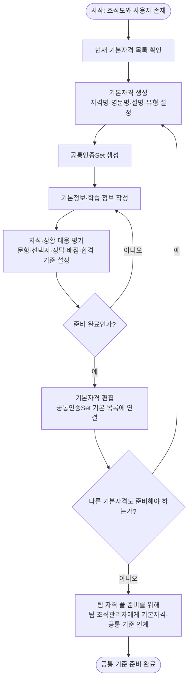
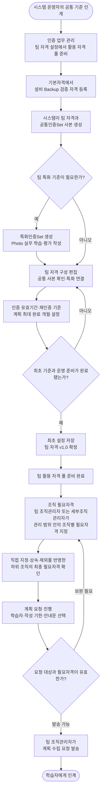
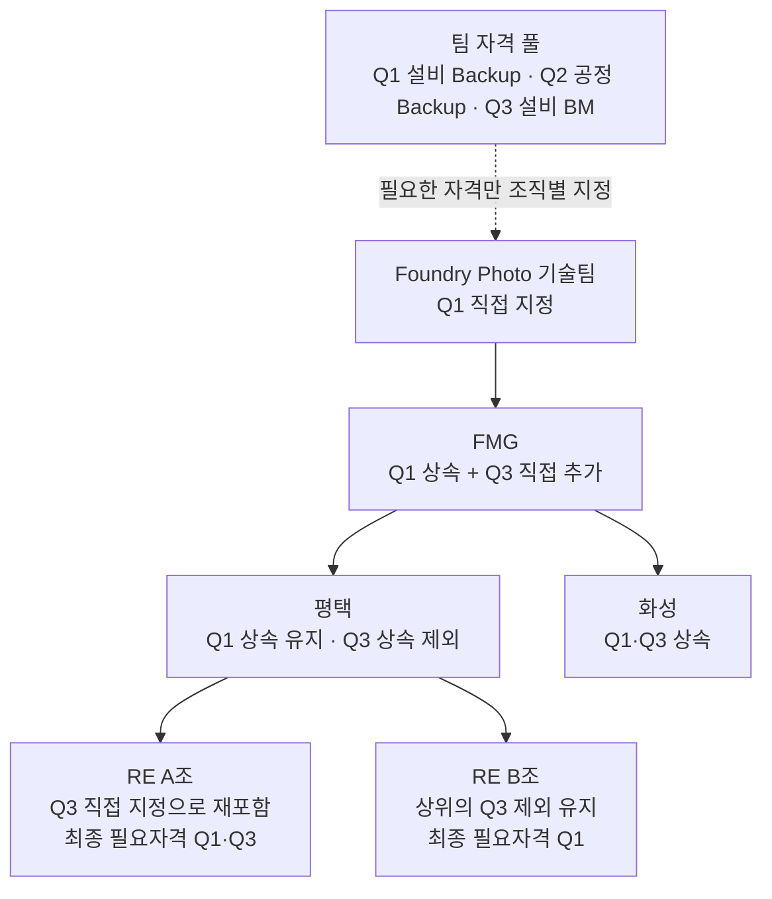
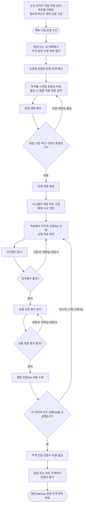
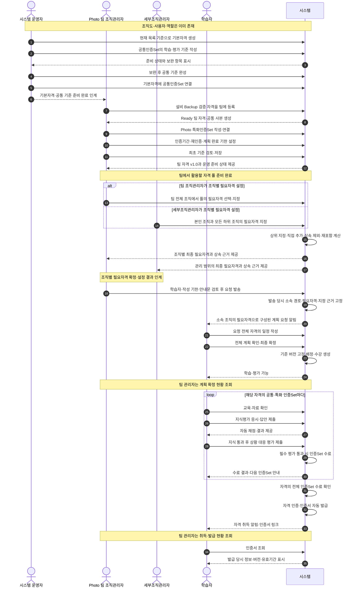

2026-11-02 상태 통합: 취득 대상자 Hold와 메뉴는 폐지했다. 사람의 상태는 active/deactive이며 일반 자격의 집계·진행에만 적용한다. 기존 Hold 사용자는 active로 전환한다. 개별 인증·자격 기준의 Hold는 유지한다. 업무 상태 변경은 팀 관리자와 시스템 운영자만 가능하다.

# Foundry Photo 기술팀 자격 인증 워크플로우

작성일: 2026-11-02 · 대상: 시스템 운영자, 팀 조직관리자, 학습자 · 조직별 설정 참여: 세부조직관리자

## 1. 시작 조건과 예시 구성

조직도와 사용자 계정, 역할 지정이 완료된 상태에서 시작한다. 시스템 운영자는 현재 목록에 있는 일반 기본자격을 새로 구성해야 하며, 공통인증Set·팀 자격·학습자의 진행 기록은 아직 없는 신규 구축 상황으로 설명한다. 현재 운영 중인 데이터를 삭제하거나 다시 만드는 절차를 뜻하지 않는다.

**마지막 단계는 학습자가 ‘설비 Backup 검증 자격’을 취득하고 발급된 인증서를 확인하는 시점이다.**

| 구분             | 이번 워크플로우의 기준                                          |
| ---------------- | --------------------------------------------------------------- |
| 대상 조직        | Foundry Photo 기술팀과 소속 하위 조직                           |
| 참여 역할        | 시스템 운영자, 팀 조직관리자, 학습자                            |
| 기본자격 준비    | 현재 목록의 일반 자격을 작성 대상으로 사용                      |
| 취득 예시        | 설비 Backup 검증 자격                                           |
| 공통인증Set 예시 | 설비 Backup 검증 공통 기준                                      |
| 특화인증Set 예시 | Photo 설비 Backup 검증 실무                                     |
| 평가 구성        | 각 인증Set에 지식평가·상황 대응 평가 사용                       |
| 학습자 조건      | 해당 조직 소속, 학습자 역할, 업무 상태 active, 업무 상태 active |

인증Set 이름과 공통 1개·특화 1개 구성은 설명용 예시다. 특화인증Set은 필요한 경우 추가하며, 합격 기준과 인증 유효기간은 관리자가 실제 업무 기준에 맞춰 설정한다. 내장 테스트 데이터의 문항 수·합격 기준을 운영 정책으로 강제하지 않는다.

기본자격은 **공통 자격 정의**, 팀 자격은 **Foundry Photo 기술팀에서 실제 운영하는 인증 기준**이다. 학습자는 팀 자격에 연결된 인증Set을 이수한다. 이번 문서는 일반 자격 취득만 다루며 별도 Auditor 절차는 포함하지 않는다.

### 역할과 책임

| 역할             | 확정하는 내용                                                  | 다음 역할에 인계하는 결과                                                             |
| ---------------- | -------------------------------------------------------------- | ------------------------------------------------------------------------------------- |
| 시스템 운영자    | 기본자격의 공통 정보, 공통인증Set 원본과 기본 연결 목록        | 팀에서 등록할 수 있는 기본자격과 공통 기준                                            |
| 팀 조직관리자    | 팀 인증Set 구성·기간·계획 기한, 조직 필요자격, 요청 대상       | 학습자에게 필요한 자격 목록과 계획 수립 요청                                          |
| 세부조직관리자   | 본인 조직과 모든 하위 조직의 필요자격 직접 지정·상속 제외·복원 | 조직별 최종 필요자격과 지정·상속 근거. 팀 자격 풀 편집·계획 요청 발송은 담당하지 않음 |
| 학습자           | 요청 전체의 일정·목표와 최종 계획, 본인의 평가 답안            | 평가·수료·발급을 판단할 본인 진행 근거                                                |
| 시스템 자동 처리 | 준비 검사, 기준 고정, 자동 채점·수료·발급                      | 현황·알림·인증서와 발급 근거                                                          |

### 팀 자격 풀과 조직 필요자격의 구분

**팀 자격 풀 준비 → 조직별 필요자격 지정 → 상속 결과 확인 → 계획 요청** 순서로 진행한다.

| 구분      | 팀 자격 설정                                        | 조직 필요자격                                                        |
| --------- | --------------------------------------------------- | -------------------------------------------------------------------- |
| 목적      | 해당 팀이 활용할 수 있는 자격 풀 준비               | 각 조직의 구성원이 확보해야 하는 자격 지정                           |
| 선택 대상 | 시스템 기본자격                                     | 팀 자격 풀의 운영 가능한 자격                                        |
| 설정 내용 | 자격 등록, 공통·특화 인증Set, 인증기간·계획 기한 등 | 조직별 직접 지정·상속 제외·복원                                      |
| 담당      | 팀 조직관리자                                       | 팀 조직관리자 또는 세부조직관리자                                    |
| 관리 범위 | 본인 팀 전체의 자격 풀                              | 팀 조직관리자는 팀 전체, 세부조직관리자는 본인 조직과 모든 하위 조직 |

**팀 자격 풀에 등록했다고 모든 조직과 구성원의 필요자격이 되는 것은 아니다.** ‘조직 필요자격’에서 지정한 결과와 상속 규칙에 따라 각 조직의 필요자격이 결정된다. 세부조직관리자는 팀 자격 풀 자체를 편집하지 않는다.

## 2. 시스템 운영자 워크플로우 — 공통 기준 준비

시스템 운영자는 기본자격의 이름·설명과 여러 팀에서 사용할 공통인증Set을 준비한다. **팀 자격 등록 전에 공통인증Set 연결을 완료**하는 것이 핵심이다.

1. **시스템 운영 → 기본자격 관리**에서 현재 목록을 기준으로 자격명·영문명·설명과 일반 자격 유형을 등록한다. 공통인증Set이 없으면 기본자격의 공통 목록을 비워 둔 상태로 먼저 저장할 수 있다.
2. **시스템 운영 → 공통인증Set 관리**에서 ‘설비 Backup 검증 공통 기준’을 만든다. 필요한 교육·자료를 작성하고 지식·상황 대응 평가를 구성한다. 학습 정보는 선택 사항이지만, 사용하도록 설정한 평가의 문항과 합격 기준은 완성해야 한다.
3. **준비 상태를 확인**한다. 미완성 내용은 저장할 수 있으나 팀에서 사용할 기준은 ‘준비 완료·운영 중’으로 준비한다. 처음부터 완성해 저장하면 v1.0이며, 보완 필요 저장은 v0.x로 보관되고 처음 준비 완료가 될 때 v1.0이 된다.
4. **기본자격에 공통인증Set을 연결**한다. ‘설비 Backup 검증 자격’의 기본 공통 목록에 준비한 원본을 연결한다. 같은 공통 기준을 사용하는 다른 기본자격에도 연결할 수 있다. 필요한 기본자격마다 이 과정을 반복한다.
5. **팀 조직관리자의 자격 풀 준비를 위해 인계**한다. 사용할 기본자격과 연결된 공통 기준이 준비되었음을 안내한다. 조직별 필요자격 지정은 팀 자격 풀 준비 후의 별도 단계다. 이 인계는 업무상 안내이며 별도의 시스템 승인이나 자동 발송 단계를 추가하는 것은 아니다.

**인계 결과:** 팀 조직관리자가 기본자격을 등록하면 적용할 공통인증Set이 준비된 상태다. 이후 기본 공통 목록을 바꿔도 이미 등록된 팀 자격에 새 항목이 자동 추가되지는 않으므로, 최초 연결을 마친 뒤 팀 등록을 진행한다.

## 3. 팀 조직관리자 워크플로우 — 팀 기준 확정과 계획 요청

팀 조직관리자는 공통 기준을 가져와 **팀이 활용할 수 있는 자격 풀**을 준비한다. 그다음 팀 조직관리자 또는 세부조직관리자가 ‘조직 필요자격’에서 조직별 필요 항목을 지정한다. 상속 결과를 확인한 후 팀 조직관리자가 학습자에게 계획을 요청한다.

1. **팀 자격 설정에서 활용할 기본자격을 등록**한다. ‘설비 Backup 검증 자격’ 등 팀에서 활용할 자격을 선택해 팀 자격 풀을 구성한다. 시스템이 팀 자격과 기본 공통인증Set의 팀 사본을 함께 만든다. 최초 팀 자격은 **Ready·대기 상태이며 내용 버전이 아직 확정되지 않는다.** 이 등록만으로 모든 조직의 필요자격이 되지는 않는다.
2. **팀 특화인증Set을 준비하고 연결**한다. 예시에서는 ‘Photo 설비 Backup 검증 실무’를 만든다. 팀의 설비·절차에 맞는 교육·자료와 지식·상황 대응 평가를 작성하고 준비 완료 후 자격에 연결한다. 팀 조직관리자는 사전 적용된 공통인증Set을 필수 구성으로 유지하고, 특화인증Set을 추가·제외한다.
3. **팀 운영 정책을 설정하고 최초 저장**한다. 인증 유효기간, 재인증 기준, **계획 확정 후 최대 완료 개월**을 설정한다. 인증기간은 기간제 또는 무기한을 명시하고, 최대 완료 개월의 신규 기본값은 6개월이다. 기준을 완성하고 최초 설정을 저장하면 팀 자격의 v1.0이 확정된다. 공통 기본값만 사용하는 경우에도 명시적으로 최초 설정을 저장한다. 준비 부족이 남아 있으면 계획 요청 전에 보완한다.
4. **팀 자격 풀 준비 완료 후 조직별 필요자격을 지정**한다. 팀 조직관리자 또는 세부조직관리자가 ‘조직 필요자격’에서 팀 풀의 운영 가능한 자격을 선택한다. 팀 전체가 필요하면 Lv1에, 특정 하위 조직만 필요하면 해당 조직에 직접 지정한다. 팀 조직관리자는 팀 전체를, 세부조직관리자는 본인 조직 및 모든 하위 조직을 설정한다.
5. **상속 결과를 확인한 뒤 계획 수립 요청을 발송**한다. 하위 조직별로 직접 지정·상속·제외가 반영된 최종 필요자격을 확인한다. 팀 조직관리자가 ‘계획 요청·진행’에서 대상자, 계획 작성 기한과 안내문을 입력하고, 해당 인원의 소속 조직에 적용되는 필요자격·준비 상태·기존 취득 및 진행 여부를 검토해 발송한다. 필요자격이 없거나 운영할 수 없는 기준이 있으면 사유를 보완한다. 세부조직관리자는 계획 요청을 발송하지 않는다.
6. **진행 현황을 확인**한다. 이후 계획·평가·수료·인증 현황을 확인한다. **학습자의 계획에 대한 별도 승인이나 평가 점수의 수동 판정 단계는 없다.**

**인계 결과:** 학습자에게 본인이 확보해야 하는 자격 목록과 계획 작성 요청이 전달된다. 요청에는 발송 당시 소속 경로와 조직 필요자격 목록·지정·상속·제외 근거가 고정된다. 이후 조직 설정 변경은 이미 발송한 요청이나 확정 계획을 자동으로 다시 쓰지 않는다. 자격·인증Set의 실제 적용 버전은 학습자의 최종 계획 확정 시 다시 확인하여 고정한다.

### 세부조직관리자의 담당

- ‘조직 필요자격’에서 **본인 조직과 모든 깊이의 하위 조직**에 필요한 자격을 직접 지정하고, 상속 제외·복원을 설정한다. 상위 조직·형제 조직·다른 팀은 관리 범위가 아니다.
- 상위 조직의 지정 출처와 하위 조직에 미치는 영향을 확인한 뒤 변경을 저장한다. 상속 제외·제외 해제에 필요한 사유는 기존 화면의 검토 절차를 따른다.
- 팀 자격 풀 자체나 자격의 인증Set·기간을 편집하지 않는다. 필요한 자격이 팀 풀에 없거나 준비 부족이면 팀 조직관리자에게 기준 준비를 요청한다.
- 조직별 필요자격을 정리한 후 팀 조직관리자에게 인계한다. 계획 요청 발송은 팀 조직관리자가 수행한다.

### 조직 필요자격의 상속 규칙

1. 상위 조직에 지정한 자격은 **모든 깊이의 하위 조직으로 상속**된다.
2. 하위 조직은 팀 자격 풀에서 필요한 자격을 직접 추가할 수 있다.
3. 상속 자격을 제외하면 해당 조직과 그 하위 조직에 제외가 적용된다.
4. 더 아래 조직에서 같은 자격을 직접 지정하면 해당 지점부터 다시 포함되고 하위로 상속된다.
5. 직접 지정을 해제하더라도 상위 조직에서 상속되는 자격은 계속 적용될 수 있다. 상속을 차단하려면 ‘상속 제외’를 사용한다. 상위 조직에서 만든 제외 자체는 하위에서 삭제하지 않고 직접 지정으로 재포함한다.
6. 동일 자격이 여러 경로에서 지정되어도 실제 필요자격은 중복 계산하지 않는다.

### Photo 기술팀 상속 예시

기존 조직도를 이용한 설명용 예시다. 실제 조직 설정은 변경하지 않는다. Q1은 ‘설비 Backup 검증 자격’, Q2는 ‘공정 Backup 검증 자격’, Q3은 ‘설비 BM 작업 자격’이다. 세 자격 모두 팀 자격 풀에 운영 가능하게 준비했다고 가정한다.

| 조직                 | 해당 조직에서의 설정               | 최종 필요자격 |
| -------------------- | ---------------------------------- | ------------- |
| Foundry Photo 기술팀 | Q1 직접 지정                       | Q1            |
| FMG                  | Q3 직접 추가                       | Q1·Q3         |
| 평택                 | Q3 상속 제외                       | Q1            |
| RE A조               | Q3 직접 지정으로 재포함            | Q1·Q3         |
| RE B조               | 별도 변경 없음. 평택의 제외를 따름 | Q1            |
| 화성                 | 별도 변경 없음. FMG에서 상속       | Q1·Q3         |

**Q2는 팀 자격 풀에 있지만 예시의 어떤 조직에도 지정하지 않았으므로 해당 구성원의 필요자격에 포함되지 않는다.** 예를 들어 RE B조 학습자는 이 조직 설정에 따른 요청에서 Q1의 일정을 수립한다. RE A조 학습자는 Q1·Q3의 일정을 같은 화면에서 수립한다.

## 4. 학습자 워크플로우 — 계획부터 인증서 확인까지

학습자의 요청 대상은 **소속 조직에 적용되는 직접 지정·상속·제외 결과**에서 결정된다. 팀 자격 풀 전체를 임의로 선택해 계획하는 것이 아니다. 학습자는 요청에 포함된 자격의 일정을 한 화면에서 확정하고, 각 자격의 인증Set별 평가를 통과한다.

1. **소속 조직의 필요자격으로 구성된 요청 전체의 계획을 수립**한다. 여러 자격이 요청되었다면 전체를 한 화면에서 작성하며, 팀 자격 풀의 다른 자격을 임의로 추가하거나 요청 자격을 제외하지 않는다. 자격별 일정을 개별 입력하거나 상단에서 일괄 적용한다. 완료일은 최종 확정일을 기준으로 해당 자격의 최대 완료 개월 이내여야 한다. 목표 입력은 선택이다. 이미 취득했거나 확정 계획으로 진행 중인 자격은 중복 계획을 만들지 않는다.
2. **전체 계획을 최종 확정**한다. 검토 후 확정하면 자격과 연결 인증Set의 적용 버전이 고정되고 배정·수강이 생성된다. 작성 중 기준이 변경되면 일정을 보존한 채 최신 기준을 재확인한다. 어느 하나라도 보완이 필요하면 전체 확정을 보류한다.
3. **인증Set별로 학습하고 평가에 응시**한다. 예시의 공통·특화 인증Set을 각각 학습한다. 각 인증Set에서 지식평가를 통과한 뒤 상황 대응 평가에 응시한다. 미통과한 평가는 학습 내용을 확인하고 재응시하며, 이미 통과한 다른 평가의 결과는 유지된다. 상황 대응 평가는 선택형 평가이며 장비 작업의 현장 관찰을 뜻하지 않는다.
4. **주관식이 있는 경우 답변을 작성**한다. 최종 필수 평가를 통과하기 전에 답변을 작성·제출할 수 있다. 주관식 답변 여부는 수료·인증 조건에 포함되지 않는다. 자료 열람 자체도 수료 처리가 되지는 않는다.
5. **자동 취득 결과와 인증서를 확인**한다. ‘설비 Backup 검증 자격’에 연결된 모든 인증Set을 수료하면 시스템이 자격 인증과 인증서를 자동 발급한다. 학습자는 알림이나 보유 자격에서 인증번호, 취득일, 유효기간과 적용 버전을 확인한다. 별도의 인증서 발급 신청이나 관리자 승인 버튼을 거치지 않는다.

**계획 요청에 여러 자격이 포함돼 있어도 인증은 자격별로 발급된다.** 이번 예시 자격의 인증Set을 모두 수료했다면 다른 자격이 진행 중이어도 해당 인증서를 받을 수 있다.

## 5. 세 역할의 통합 워크플로우

아래 다이어그램은 세 기본 역할과 조직별 필요자격 설정에 참여하는 세부조직관리자, 시스템의 자동 처리를 함께 보여준다. ‘인계’는 업무상 기준 전달이며, 학습자의 계획 요청과 취득 알림은 실제 시스템 기능이다.

| 인계 지점                                   | 인계하는 내용                                        | 다음 단계의 시작 조건                                                                 |
| ------------------------------------------- | ---------------------------------------------------- | ------------------------------------------------------------------------------------- |
| 시스템 운영자 → 팀 조직관리자               | 기본자격과 연결된 공통인증Set 원본                   | 공통 기준이 준비 완료이고 기본자격 연결이 끝남                                        |
| 팀 자격 풀 준비 완료 → 조직별 필요자격 설정 | 팀 조직관리자가 준비한 운영 가능한 자격 목록         | 팀 조직관리자 또는 세부조직관리자가 관리 범위의 조직에서 필요한 항목을 선택할 수 있음 |
| 조직별 필요자격 확정 → 팀 조직관리자        | 직접 지정·상속·제외·재포함을 반영한 최종 목록과 근거 | 대상자 소속 조직의 상속 결과를 확인하고 계획 요청을 검토할 수 있음                    |
| 팀 조직관리자 → 학습자                      | 소속 조직에 적용되는 필요자격과 계획 작성 요청       | 팀 기준이 운영 가능하고 대상자가 요청을 수신함                                        |
| 학습자 → 시스템                             | 전체 계획의 최종 확인                                | 일정·완료 기한·최신 기준 검증 통과                                                    |
| 시스템 → 학습자·팀 조직관리자               | 수료 결과, 자격 취득과 인증서                        | 해당 자격의 모든 연결 인증Set 수료. 관리자는 현황에서 확인                            |

이 흐름에서 **사람이 확정하는 것은 공통 기준, 팀 자격 풀, 조직별 필요자격, 학습자의 계획**이다. **채점·인증Set 수료·자격 인증·인증서 발급은 시스템이 처리**하며, 계획 확정 이후 기준이 개정되어도 해당 학습자의 절차와 인증서는 확정 당시 버전을 따른다.

조직별 필요자격은 팀 조직관리자 또는 세부조직관리자가 관리 범위에서 저장한다. 요청의 필요자격 목록과 지정 근거는 **발송 시점**에 고정되므로, 이후 조직 필요자격을 바꿔도 기존 요청이나 확정 계획은 자동 변경되지 않는다.

### 진행이 보류될 때

| 보류 지점                             | 확인할 내용                                                | 보완 담당                                                 |
| ------------------------------------- | ---------------------------------------------------------- | --------------------------------------------------------- |
| 공통/특화 준비 부족                   | 평가 문항·정답·배점·합격 기준, 추가한 학습 정보의 누락     | 공통 원본은 운영자, 팀 특화는 팀 조직관리자               |
| 팀 자격 Ready 또는 준비 부족          | 최초 기준 저장, 인증기간, 연결 인증Set, 계획 완료 기한     | 팀 조직관리자                                             |
| 조직별 필요자격 누락·상속 결과 불일치 | 직접 지정·상위 출처·상속 제외·재포함                       | 관리 범위의 팀 조직관리자 또는 세부조직관리자             |
| 계획 요청 불가                        | 조직 필요자격·소속·학습자 역할·업무 상태·취득 대상자 Hold  | 팀 조직관리자. 필요자격 보완은 세부조직관리자와 협업 가능 |
| 계획 최종 확인 보류                   | 날짜와 허용 완료일, 기준 변경 재확인, 다른 필요자격의 오류 | 학습자, 기준 보완이 필요하면 팀 조직관리자                |
| 평가 미통과                           | 학습 내용과 해당 평가의 합격 기준                          | 학습자                                                    |
| 일부 인증Set만 수료                   | 같은 자격의 나머지 공통/특화 인증Set                       | 학습자                                                    |

운영 기준의 상세 계약은 [공통인증Set 운영](COMMON_COURSES.md), [조직 필요자격](ORGANIZATION_REQUIREMENTS.md), [전체 계획 일정](QUALIFICATION_PLANS.md), [버전 운영](RELEASE_VERSIONS.md), [주관식 답변](SUBJECTIVE_RESPONSES.md), [업무 상태](WORK_STATUS.md)를 따른다.
