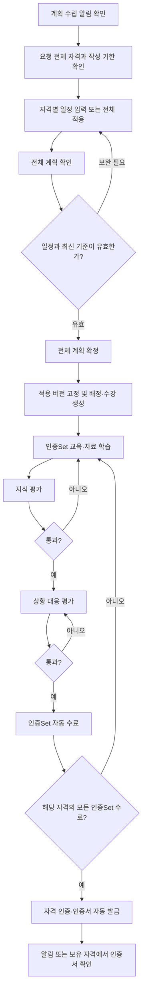

# 학습자 안내 — 계획 알림부터 자격 인증서까지

이 문서는 일반 자격을 처음 취득하거나 다시 취득하는 학습자를 위한 안내다. 관리자가 보낸 계획 수립 알림을 받은 시점부터 인증Set 수료와 자격 인증서 확인까지 설명한다. Auditor 전용 취득 절차와 별도 재인증 절차는 이 흐름과 구분한다.

예시는 Foundry Photo 기술팀의 **설비 Backup 검증 자격**이며, ‘설비 Backup 검증 공통 기준’과 ‘Photo 설비 Backup 검증 실무’ 인증Set을 연결한 경우다. 이름·인증Set 수·평가 합격 기준은 실제 팀 설정에 따라 달라진다.

## 1. 먼저 알아둘 기준

| 용어          | 학습자에게 의미하는 것                                                                                  |
| ------------- | ------------------------------------------------------------------------------------------------------- |
| 팀 자격 풀    | 팀에서 활용할 수 있도록 관리자가 준비한 자격 목록이다. 모두가 이 목록 전체를 취득해야 하는 것은 아니다. |
| 조직 필요자격 | 소속 조직의 직접 지정, 상위 조직의 상속, 상속 제외·재포함을 계산한 필요자격이다.                        |
| 계획 요청     | 관리자가 대상 자격·작성 기한·안내문을 정해 보낸 요청이다. 발송 당시 필요자격과 지정 근거를 보존한다.    |
| 인증Set       | 자격을 구성하는 학습·평가 단위다. 하나의 자격에 여러 인증Set이 연결될 수 있다.                          |
| 인증Set 수료  | 해당 인증Set에서 사용하는 필수 평가를 모두 통과한 상태다.                                               |
| 자격 인증     | 자격에 연결된 모든 인증Set을 수료해 자격을 취득한 상태다. 인증서가 자동 발급된다.                       |

학습자 역할과 사용 중인 소속 조직이 필요하다. 업무 상태가 **deactive**이면 현재 팀의 일반 자격 진행이 중단된다. 계정 선택·기록 조회와 진행 가능 여부는 서로 다르다.

## 2. 전체 진행 순서

그림은 지식·상황 대응 평가를 모두 사용하는 예시다. 실제로 사용하도록 설정된 평가만 진행한다. 관리자가 학습자의 계획을 별도 승인하거나 점수를 수동 판정하는 단계는 없다.

## 3. 계획 수립 알림 받기

1. 본인 계정으로 접속한다. 헤더 **알림** 또는 홈의 알림에서 계획 수립 요청을 확인한다.
2. 요청의 상세 이동 링크를 열거나 **자격 취득 → 계획**으로 이동한다.
3. **자격 일정 수립** 화면에서 요청자 안내문, 계획 작성 기한, 대상 자격 수를 확인한다. 요청이 여러 개면 작성할 요청을 선택한다. 기본적으로 최신 요청이 표시된다.
4. 본인 조직에 적용된 필요자격을 확인한다. 팀 자격 풀 전체를 임의로 계획하는 과정이 아니다. 허용된 추가 자격은 같은 화면에서 선택할 수 있다.

알림을 읽는 것만으로 계획이 확정되거나 학습이 시작되지는 않는다. 조직 필요자격이 나중에 바뀌어도 이미 발송된 요청의 대상과 근거를 자동으로 다시 작성하지 않는다. 누락·오류가 있으면 팀 관리자에게 요청 내용을 확인한다.

## 4. 전체 자격 일정 작성

### 작성 기한과 완료 기한의 차이

| 구분                 | 확인할 내용                                                                                                                                    |
| -------------------- | ---------------------------------------------------------------------------------------------------------------------------------------------- |
| 계획 작성 기한       | 관리자가 요청에 지정한 계획 작성 기한이다.                                                                                                     |
| 자격별 시작일·완료일 | 실제로 취득을 진행할 일정이다. 인증Set별로 별도 일정을 작성하지 않는다.                                                                        |
| 최대 완료 개월       | 관리자가 자격별로 설정한다. 신규 기본값은 6개월이며 실제 화면의 값을 따른다.                                                                   |
| 허용 완료일          | 최종 계획 확정일의 한국 날짜를 기준으로 최대 완료 개월을 더한 날짜다. 해당 날짜가 없는 달은 말일까지이며, 허용 완료일 당일까지 입력할 수 있다. |

작성 중 표시되는 허용 완료일은 서버의 오늘 기준 예상값이다. 날짜가 바뀌거나 자격 정책이 변경되면 최종 확인에서 다시 검사한다. 최대 완료 개월은 계획 일정의 입력 범위이며, 기한 경과만으로 학습·평가를 자동 차단하는 규칙은 아니다.

### 자격별 입력

1. 각 자격의 이름·버전·준비 상태·허용 완료일을 확인한다.
2. 시작일과 완료일을 입력한다. 완료일은 시작일보다 빠를 수 없고 자격별 허용 완료일을 넘을 수 없다.
3. 필요하면 목표를 작성하고 포함 인증Set을 펼쳐 학습 범위를 확인한다.
4. 이미 취득했거나 확정 계획으로 진행 중인 자격은 읽기 전용으로 확인한다. 해당 항목은 일괄 적용 대상에서 제외된다.
5. 준비 부족 항목은 표시된 보류 이유를 확인하고 관리자에게 보완을 요청한다.

날짜를 다 입력하지 않은 초안도 저장할 수 있다. 자동 저장 상태를 확인하고 저장 실패 안내가 있으면 재시도한다. 초안 저장은 전체 계획 확정과 다르다.

### 일괄 일정 적용

상단 **전체 일정 설정**에서 일괄 시작일·일괄 완료일을 입력하고 **전체 적용**을 누른다. 편집 가능한 모든 대상에 적용된다. 기존 일정을 덮어쓰는 경우 확인창에서 검토한 뒤 적용하며 취소하면 기존 입력을 유지한다.

한 자격이라도 날짜 역전이나 기한 초과가 있으면 **아무 일정도 바뀌지 않는다**. 오류에 표시된 자격과 가장 빠른 허용 완료일을 확인해 다시 입력한다. 일괄 적용 후에도 각 자격의 일정을 개별 조정할 수 있다.

## 5. 전체 계획 확인과 확정

1. **전체 계획 확인**을 누른다. 오류 요약이 나타나면 해당 항목으로 이동해 수정한다.
2. **전체 계획 최종 확인**에서 대상 자격, 일정, 목표, 적용 버전과 완료 기한을 검토한다.
3. 작성 도중 기준이 바뀌었다면 이전·최신 기준 차이를 확인한다. 일정·목표는 보존되며 최신 기준을 다시 확인해야 한다.
4. **전체 계획 확정**을 누른다. 요청 전체의 계획·배정·수강 생성과 요청 완료가 함께 처리된다. 일부 자격만 먼저 확정되는 방식이 아니다.

검토 이후 권한·조직·일정·버전 등이 다시 변경되면 확정이 보류된다. 입력을 확인하고 최신 기준으로 다시 검토한다. 응답이 늦거나 저장에 실패했다면 화면의 재시도를 사용하고, 같은 내용을 별도 계획으로 중복 생성하지 않는다.

취득·진행 중인 자격만 있어 새로 계획할 대상이 없으면 **추가 계획 대상 없음 확인**을 진행한다. 필요자격이 없는 요청은 허용된 추가 자격 선택과 화면의 최소 계획 조건을 따른다.

확정 시 자격과 인증Set의 버전, 자격 정책, 완료 기한을 고정한다. 이후 관리자가 최신 기준을 수정해도 해당 확정 절차의 문항·채점·인증서는 당시 기준을 따른다.

## 6. 인증Set별 학습

**자격 취득 → 학습**에서 계획을 확정한 자격을 선택하고 연결된 인증Set을 확인한다. 예시 자격은 공통 기준과 Photo 실무 두 인증Set을 각각 완료해야 한다.

교육 내용과 자료를 읽고 업무 절차·판단 기준을 이해한다. 직접 작성 자료와 외부 링크는 해당 방식으로 확인한다. 일반 자격의 교육·자료 열람 자체는 평가 통과나 인증Set 수료를 뜻하지 않는다. 학습 정보가 없는 인증Set도 설정된 평가 기준을 충족하면 운영할 수 있다.

## 7. 지식·상황 대응 평가와 주관식

### 지식 평가

1. 해당 인증Set의 지식 평가를 시작한다. 문항 수·배점·합격 기준은 실제 평가 안내를 확인한다.
2. 각 문항을 읽고 답을 선택한다. 임시 저장 상태와 미응답 문항을 확인한다.
3. **답안 확인**에서 전체 답을 검토한다. 미응답 문항이 있으면 모두 답한 뒤 제출한다.
4. **제출 전 답안 확인**을 거쳐 **최종 제출**한다. 제출한 답안은 수정하지 못하며 자동 채점 결과를 확인한다.

### 상황 대응 평가

두 평가를 모두 사용하는 인증Set에서는 지식 평가 통과 후 상황 대응 평가를 진행한다. 상황 설명과 질문을 함께 읽고 답을 선택한 뒤 확인·최종 제출한다. 미통과하면 내용을 다시 학습하고 해당 평가에 재응시한다. 이미 통과한 다른 평가 결과는 유지된다.

합격 기준은 관리자가 정한 실제 기준이다. 내장 테스트 데이터의 점수·문항 수·정답 표시는 일반 업무 인증Set의 규칙이 아니다.

### 주관식 답변

주관식이 설정되어 있다면 업무 경험이나 판단 근거를 작성·제출할 수 있다. 답변 여부는 점수·수료·인증 조건에 포함되지 않는다. 답변을 남기려면 **마지막 필수 평가를 통과하기 전에** 작성·제출한다. 필수 평가 통과로 수료되면 이후 작성이 제한될 수 있다.

## 8. 인증Set 수료와 자격 인증서

필수 평가를 모두 통과하면 해당 인증Set이 자동 수료된다. 수료 결과와 제공되는 수료증을 확인하고, 자격에 남아 있는 인증Set으로 이동한다.

| 현재 결과                              | 다음 행동                                         |
| -------------------------------------- | ------------------------------------------------- |
| 인증Set 하나 수료, 다른 인증Set 미수료 | 남은 인증Set을 학습하고 평가를 통과한다.          |
| 한 자격의 모든 인증Set 수료            | 시스템이 해당 자격 인증과 인증서를 자동 발급한다. |
| 요청의 다른 자격은 아직 진행 중        | 완료된 자격의 인증서는 먼저 확인할 수 있다.       |

취득 알림 또는 헤더 **보유 자격**에서 해당 자격을 열고 **자격 인증서**를 확인한다. 인증번호, 취득일, 유효기간 또는 무기한 여부, 적용 자격·인증Set 버전을 확인한다. 인증Set 수료증과 자격 인증서는 서로 다른 근거다.

재조회 시에도 발급 당시 이름·정책·버전을 사용한다. 현재 인증 효력이 Hold·만료·말소 상태라면 과거 발급 기록이 있다고 현재 유효한 인증으로 보지 않는다. 별도 발급 신청이나 관리자 수동 발급 절차는 필요하지 않다.

## 9. 업무 상태와 문제 해결

deactive 중에도 인증 유효기간과 기존 일정은 계속 흐른다. active 복귀가 유효기간을 연장하거나 만료·말소 인증을 복원하지 않는다. 연속 deactive 6개월이 되는 날의 다음 날부터 현재 팀의 일반 자격 인증 말소와 미완료 절차 종료 대상이 된다. 이후 active로 복귀하면 관리자의 새 계획 요청에 따라 새 학습·평가로 재취득한다.

| 화면에서 겪는 문제                  | 확인할 내용                                                                                  |
| ----------------------------------- | -------------------------------------------------------------------------------------------- |
| 계획 요청이 보이지 않음             | 본인 계정·소속과 관리자 요청 발송 여부를 확인한다.                                           |
| 일정 전체 적용이 되지 않음          | 오류 자격의 시작·완료일과 가장 빠른 허용 완료일을 확인한다.                                  |
| 기준 변경으로 확정 보류             | 보존된 일정·목표를 확인한 뒤 최신 버전을 다시 검토한다.                                      |
| 상황 대응 평가를 시작할 수 없음     | 지식 평가 통과와 현재 업무·조직·자격 운영 상태를 확인한다.                                   |
| 평가 통과 후에도 자격 인증서가 없음 | 같은 자격에 남은 인증Set과 해당 평가의 수료 상태를 확인한다.                                 |
| 저장 실패·충돌 안내                 | 입력을 유지하고 화면의 재시도·재확인 절차를 따른다. 계정을 바꾸기 전에 저장 상태를 확인한다. |

관리자 역할과 조직 필요자격의 상속은 [Foundry Photo 기술팀 자격 인증 워크플로우](FOUNDRY_PHOTO_WORKFLOW.md), 업무 상태와 운영 메뉴는 [시스템 운영 상세 안내](SYSTEM_OPERATIONS_GUIDE.md)를 참고한다.
