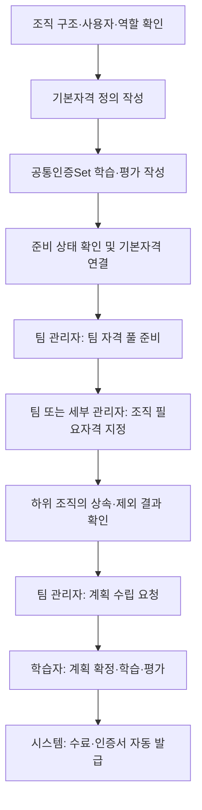
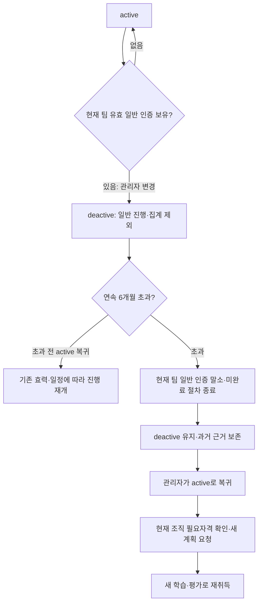

# 시스템 운영 상세 안내 — 사용자·조직·기준 관리

이 문서는 시스템 운영자가 공통 기준, 조직 구조, 사용자, 공지와 시험 환경을 관리하는 절차를 설명한다. **문서 조회는 헤더의 독립 메뉴**이며 로그인한 사용자가 읽을 수 있다. 문서를 볼 수 있다고 시스템 운영 권한이 생기지는 않는다.

## 1. 메뉴와 권한 구분

| 시스템 운영 메뉴   | 담당하는 일                                             | 다른 업무와의 구분                                                             |
| ------------------ | ------------------------------------------------------- | ------------------------------------------------------------------------------ |
| 기본자격 관리      | 여러 팀이 사용할 공통 자격 정의와 기본 공통인증Set 목록 | 실제 팀의 자격 풀·운영 정책은 팀 자격 설정에서 완성한다.                       |
| 공통인증Set 관리   | 공통 학습·평가 원본 작성과 버전 관리                    | 팀은 원본의 사본과 팀 특화 인증Set을 운영한다.                                 |
| 조직 관리          | 조직 구조·사용 상태와 Lv1 Auditor 대상 팀 설정          | 조직 설명·담당 업무·관리자·필요자격은 인증 업무 관리의 해당 메뉴에서 관리한다. |
| 사용자 관리        | 계정·역할·소속과 업무 상태                              | 업무 상태 변경은 사용자 기본정보 저장과 별도로 처리한다.                       |
| 전체 업무 조회     | 조직별 배정·평가·자격·기준·공지·변경 이력 확인          | 조회 결과에서 과거 평가 답안이나 발급 근거를 수정하지 않는다.                  |
| 테스트 데이터 관리 | 내장 기준 로드와 전체 업무 데이터 초기화                | 실제 인증·버전까지 삭제하는 초기화이므로 운영 데이터와 구분해 사용한다.        |
| 시스템 공지 관리   | 전체 조직에 안내할 공지 작성·게시                       | 팀 공지와 개인 계획 수립 요청은 별도 기능이다.                                 |

팀 조직관리자는 본인 팀의 자격 풀·사용자·계획 요청을 관리한다. 세부조직관리자는 본인 조직과 모든 깊이의 하위 조직에서 조직 정보·필요자격·현황을 관리한다. 상위·형제·다른 팀은 관리 범위가 아니며, 팀 자격 편집·사용자 정보 변경·업무 상태 변경·계획 요청 발송 권한이 추가되지는 않는다.

## 2. 운영 준비 순서

기존 조직도와 사용자가 있다면 이를 재생성하지 않고 확인부터 시작한다. 기본자격에 공통인증Set을 연결한 뒤 팀 등록을 진행하면 기본 공통 사본을 함께 적용할 수 있다.

## 3. 기본자격 관리

**시스템 운영 → 기본자격 관리**에서 현재 목록을 검색하고 기본자격을 추가하거나 편집한다.

1. 자격명·영문명·설명을 작성하고 용도에 맞는 유형·소유 범위를 확인한다. Auditor 전용 기준은 필요한 경우에만 설정한다.
2. 공통인증Set이 아직 없다면 기본 공통 목록을 비워 두고 저장할 수 있다.
3. 공통인증Set을 준비한 뒤 같은 유형의 원본을 기본 공통 목록에 연결한다.
4. 저장 후 등록할 팀에 공통 기준 준비 완료를 안내한다.

기본자격은 공통 정의이며 팀 자격의 운영 버전과 다르다. 이름·영문명·설명 변경은 연결된 최신 팀 자격의 새 마이너 버전으로 반영되지만 확정된 계획과 발급 근거는 유지한다. 기본 공통 목록을 바꾸어도 이미 등록된 팀 자격에 새 인증Set이 자동 추가되지는 않는다.

팀 자격에 아직 등록되지 않았고 다른 기본자격의 선행 기준으로 사용되지 않은 항목만 삭제할 수 있다. 과거·삭제된 팀 자격 버전의 연결도 사용 여부에 포함하며 이전 팀 전용 기본자격은 보존한다. 삭제 불가 사유와 확인창을 확인한 뒤 실행한다. 팀의 자격 풀에서 제외하는 일과 기본자격 원본을 삭제하는 일은 구분한다.

## 4. 공통인증Set 관리

**시스템 운영 → 공통인증Set 관리**에서 원본을 만들고 기본정보·학습 정보·평가 기준을 작성한다.

### 학습 정보

교육 추가 또는 자료 추가로 항목을 만들고 세로 탭에서 바로 편집한다. 교육을 먼저, 자료를 다음으로 표시하며 같은 구분 안에서 순서를 바꿀 수 있다. 인증Set 저장 시 항목을 함께 저장한다.

| 구분 | 제공 유형                              | 주요 입력                 |
| ---- | -------------------------------------- | ------------------------- |
| 교육 | MTC교육·팀 특화 교육·현업 OJT          | 교육 종류·이름·필수 여부  |
| 자료 | 직접 작성·EDM Link·Confluence·일반 URL | 자료명·본문 또는 URL·설명 |

일반 자격의 학습 정보는 선택 사항이다. Auditor는 빈 내용도 저장할 수 있으나 운영하려면 필수 교육이 하나 이상 필요하다. 자료 열람을 일반 자격 수료 조건으로 추가하지 않는다.

### 평가와 버전

사용할 지식·상황 대응 평가의 문항·선택지·정답·배점·합격 기준을 완성한다. 주관식은 필요할 때 사용하며 채점·수료 조건과 구분한다. 미완성 내용도 저장할 수 있지만 준비 부족 항목을 보완해야 운영할 수 있다.

- 최초 보완 필요 상태는 `v0.1`부터 시작한다. 보완 필요 단계의 변경은 마이너로 기록한다.
- 처음 준비 완료가 되면 `v1.0`이 된다. 이후 준비 완료 기준의 채점 문항 변경은 메이저, 그 외 내용 변경은 마이너로 구분한다.
- 내용 버전은 `v메이저.마이너`이며 과거 버전은 읽기 전용이다. 운영 종료 등 상태 이력은 내용 버전과 구분한다.
- 완성된 원본은 원본 반영 이후 팀 수정이 없는 사본에 새 버전으로 전파하고 연결 자격도 갱신한다. 팀 수정이 있는 사본은 덮어쓰지 않고 비교·반영 여부를 검토한다.
- 미완성 원본은 팀에 전파하지 않는다. 확정된 계획·학습·발급 기록은 고정된 과거 기준을 계속 사용한다.

## 5. 조직 관리

### 조직 구조와 사용 상태

**시스템 운영 → 조직 관리**에서 트리를 검색하거나 펼쳐 조직을 선택한다. 같은 이름이라도 전체 경로를 확인한다. 권한과 상속은 이름이 아닌 조직 ID와 실제 계층을 기준으로 한다.

1. Lv1 또는 하위 조직을 추가하고 이름·상위 조직·사용 여부를 확인한다.
2. 기존 조직을 수정할 때 하위 조직과 구성원에 미치는 영향을 확인한다. 화면에서 허용하지 않는 팀 간 이동은 수행할 수 없다.
3. 같은 수준의 순서는 위로·아래로 이동해 조정한다.
4. 저장 전 변경 내용을 확인한다. 사용 중지 시 하위 조직에도 진행 제한이 영향을 줄 수 있다. 계정과 과거 발급 기록을 삭제하는 동작은 아니다.

조직 설명·담당 업무·관리자 지정은 **인증 업무 관리 → 조직 정보·관리자**에서 관리한다. 조직 필요자격은 별도 메뉴에서 설정한다. 구조 편집, 관리자 지정, 필요자격 지정은 서로 다른 작업이다.

### 조직 필요자격과 상속

팀 관리자는 먼저 **팀 자격 설정**에서 팀이 활용할 자격 풀을 완성한다. 이후 팀 관리자 또는 권한 범위 안의 세부조직관리자가 **조직 필요자격**에서 조직별로 지정한다. 풀에 등록한 것만으로 모든 구성원의 필요자격이 되지는 않는다.

| 설정                     | 적용 결과                                                                              |
| ------------------------ | -------------------------------------------------------------------------------------- |
| 상위 조직 직접 지정      | 모든 깊이의 하위 조직으로 상속된다.                                                    |
| 하위 조직 직접 추가      | 그 조직부터 해당 자격을 포함하고 아래로 상속한다.                                      |
| 상속 제외                | 그 조직과 하위 조직에서 해당 상속 자격을 제외한다.                                     |
| 더 아래 조직 직접 재지정 | 해당 지점부터 다시 포함하고 아래로 상속한다.                                           |
| 직접 지정 해제           | 상위에서 상속되는 자격이 있다면 계속 적용될 수 있다. 상속 차단은 상속 제외로 처리한다. |

같은 자격은 중복 계산하지 않는다. 저장 전 영향 조직·인원을 검토하고 최종 상속 결과를 확인한다. 계획 요청 발송 시 대상 목록과 지정 근거를 고정하므로 이후 조직 설정 변경이 기존 요청·확정 계획을 자동 변경하지 않는다.

### Lv1 Auditor 대상 팀 설정

필요한 Lv1만 **Auditor 대상 팀**으로 설정한다. 하위 조직은 Lv1 설정을 따르며 개인별 Auditor 역할 체크는 제공하지 않는다.

1. Lv1 조직을 선택하고 별도 Auditor 대상 팀 영역에서 현재 사용 여부를 확인한다.
2. **변경**을 눌러 사용·미사용을 선택한다.
3. 변경 검토 결과의 소속 인원·진행 회차·보유 인증 수와 영향을 확인한다.
4. **변경 확정**으로 저장하거나 취소한다. 조직 정보에 미저장 변경이 있으면 먼저 저장하거나 취소한다.

대상 팀의 모든 소속 인원은 계정 역할과 관계없이 취득 기회를 갖지만, 지정만으로 학습 시작이나 인증 발급이 실행되지는 않는다. 필수 교육·일반/메인 선행 조건·조직 사용 상태 등 준비 조건을 충족해야 한다. 미사용 전환은 신규 취득·갱신을 제한하고 이미 시작한 회차와 기존 인증 근거는 보존한다. 일반 자격의 deactive 중단·집계 제외 정책을 Auditor에 적용하지 않는다.

## 6. 사용자 관리와 active / deactive

### 계정 정보 수정

**시스템 운영 → 사용자 관리**에서 이름·조직·역할을 확인하고 사용자를 추가·수정한다. 신규 사용자는 active다. 역할 변경과 조직 관리자 지정은 서로 구분하며, 소속 변경 시 기존 관리자 지정에 미치는 영향을 확인한다. 현재 화면에서 허용하는 조직 범위만 선택할 수 있다.

팀 관리자는 **인증 업무 관리 → 팀 사용자 관리**에서 본인 팀의 사용자를 관리한다. 팀 사용자 추가·수정창은 검색·펼치기·접기가 가능한 조직 트리를 제공한다. 긴 목록은 내부 스크롤되며 선택 경로를 확인한 뒤 사용자 저장으로 반영한다. 시스템 사용자 관리의 조직 선택 방식과는 다르다.

### 업무 상태 변경 위치와 제한

두 사용자 관리 화면의 목록과 수정창에 현재 상태와 **업무 상태 변경** 버튼을 표시한다. 버튼은 자격이 없어도 숨기지 않으며, 사용할 수 없는 이유를 함께 표시한다.

| 상황                                                        | 가능한 행동과 안내                                                      |
| ----------------------------------------------------------- | ----------------------------------------------------------------------- |
| active이며 현재 팀의 유효한 일반 자격 인증이 하나 이상 있음 | deactive 전환 가능                                                      |
| active이며 유효 인증이 없음                                 | 버튼 비활성화: “유효한 자격 인증이 없어 deactive로 변경할 수 없습니다.” |
| deactive에서 active로 복귀                                  | 인증 보유 조건 없이 가능. 다른 운영 제한은 별도 유지                    |
| 사용자 정보를 수정 중                                       | 버튼 비활성화: “사용자 정보를 먼저 저장하거나 취소해 주세요.”           |
| 신규 사용자 작성 중                                         | 먼저 active로 저장한 뒤 업무 상태 변경                                  |
| 권한이 없음                                                 | 비활성 사유 표시. 팀 관리자·시스템 운영자만 변경 가능                   |

Hold·만료·말소 상태의 인증은 유효 인증 보유 조건에 포함하지 않는다. 변경창은 이름과 `active → deactive` 또는 반대 방향을 확인하고 변경·취소하는 간결한 구성이다. 변경 사유를 입력하지 않는다. 사용자 정보와 업무 상태는 각각 저장하며, 실패·충돌하면 안내에 따라 최신 상태를 확인한다.

### deactive가 미치는 영향

- 로그인·계정 역할은 유지한다. 현재 팀의 일반 자격 계획·학습 완료·평가·발급·재인증 진행을 중단한다.
- 일반 자격 현황에서 해당 인원과 실적을 모수·분자·비율·계획·재인증 지표에서 함께 제외한다. 조직 비활성과 겹쳐도 제외 인원을 중복 계산하지 않는다.
- Auditor 진행과 집계에는 deactive 정책을 적용하지 않는다.
- 인증 유효기간과 기존 일정은 계속 흐른다. **deactive 기간만큼 인증 유효기간을 늘리지 않는다.**

### 연속 6개월 초과와 복귀

서버의 한국 날짜를 기준으로 상태를 저장한 날부터 달력 6개월을 계산한다. 없는 날짜는 말일로 맞추고, 6개월이 되는 날까지 유지한 뒤 다음 날 0시부터 말소 대상이다. 예를 들어 2026년 10월 29일 전환했다면 2027년 4월 29일까지 유지하고 4월 30일부터 처리한다.

처리 시점 소속 팀의 일반 자격 인증 전체가 대상이며 인증 Hold도 포함한다. Auditor와 다른 팀 인증은 유지한다. 과거 계획 내용·버전·답안·수료·발급 근거는 보존하지만 종료한 회차의 수료를 새 취득에 재사용하지 않는다.

말소 후 복귀해도 인증은 자동 복원되지 않으며 새 계획 요청을 자동 생성하지 않는다. 관리자가 현재 조직 필요자격을 확인해 새 요청을 보낸다. 같은 상태 재저장은 시작일을 갱신하지 않고, active 복귀 후 다시 deactive로 변경하면 새 연속 기간을 시작한다. 소급 시작일 입력은 제공하지 않는다.

### Hold와 혼동하지 않기

사람의 취득 대상자 Hold와 해당 메뉴는 제거되었다. 사람의 업무 상태는 active / deactive만 사용한다. **자격 기준이나 발급된 인증 자체의 Hold는 별도의 효력 상태로 남아 있다.** active 복귀가 이러한 Hold·만료·말소를 해제하지 않는다.

## 7. 전체 업무 조회

**시스템 운영 → 전체 업무 조회**에서 대상 조직을 선택하고 **배정·평가 결과 / 자격 / 인증Set·평가 기준 / 공지 / 변경 이력**을 확인한다. 현재 운영 기준과 확정·발급 당시 근거를 구분한다.

다른 팀의 상황을 조회하는 것과 본인의 Auditor 취득 대상 팀을 바꾸는 것은 다르다. 개인 대상 여부는 본인 소속 Lv1, 관리 화면은 현재 관리 중인 Lv1을 기준으로 한다. 설정 수정이 필요하면 해당 관리 메뉴로 이동하고 과거 기록을 현재 기준으로 다시 쓰지 않는다.

## 8. 테스트 데이터 관리

이 메뉴는 파일 선택 없이 내장된 기준을 반복 시험하기 위한 기능이다. **테스트 데이터 로드 / 전체 데이터 초기화** 두 동작만 제공한다. 기존 데이터가 있으면 로드할 수 없고 자동으로 초기화하지 않는다.

### 로드 구성과 이후 준비

| 항목                  | 내장 구성                                                           |
| --------------------- | ------------------------------------------------------------------- |
| 기본자격              | 고정 원본 19개                                                      |
| 공통인증Set 원본      | 총 5개: 일반 3개·Auditor 2개                                        |
| 활성 팀별 특화인증Set | 10개: 일반 6개·Auditor 4개                                          |
| 일반 평가             | 지식 3개·상황 3개, 각각 34·33·33점으로 총 100점·합격 100점          |
| 정답·주관식           | 객관식 질문 끝에 실제 정답 번호 표시, 주관식 1개는 수료에 영향 없음 |
| 학습 정보             | 교육 3종·자료 4종 예시, Auditor는 평가 대신 필수 교육 확인          |

로드는 팀 자격·공통 사본·조직 필요자격을 자동으로 구성하지 않는다. **기본자격에 공통 원본 연결 → 팀 자격 등록·최초 설정 → 조직 필요자격 지정 → 계획 요청**을 실제 메뉴에서 진행한다. Auditor 대상 팀도 필요한 경우 별도로 설정하며 계정에 개인 Auditor 역할을 부여하지 않는다.

현재 건수와 로드 구성을 검토하고 확인 문구 **테스트 로드**를 입력해 실행한다. 완료 후 세션이 종료되므로 다시 접속한다.

### 전체 초기화의 범위

확인 문구는 **전체 초기화**다. 테스트로 생성했는지와 관계없이 기본자격·팀 자격·인증Set·모든 버전·계획·평가·수료·인증서·공지·업무 이력을 삭제한다. 조직 설명·담당 업무·필요자격 등 부가 정보도 지우며 Auditor 대상 팀 설정은 미사용으로 돌아간다.

계정·역할·소속·계정별 관리 권한과 업무 상태, 접속에 필요한 조직 ID·이름·상하위 구조·사용 상태는 보존한다. 자동 백업·세대·최소 실행 영수증은 복구와 중복 방지를 위해 유지한다. 초기화는 인증서나 과거 버전까지 지우므로 현황 확인이나 개별 사용자 상태 변경을 대신하는 기능이 아니다.

미리보기 후 데이터가 변경되었거나 확인 정보가 만료되면 다시 검토해야 한다. 실행 완료 시 모든 세션이 종료되고 이전 화면의 초안 저장이 차단된다. 빈 상태에서만 다시 로드하며 웹 화면에서 파일 복원·선택 삭제·데이터 이전 기능은 제공하지 않는다.

## 9. 시스템 공지 관리

**시스템 운영 → 시스템 공지 관리**에서 공지를 추가·검색·수정한다. 제목과 본문에 대상·요청 행동·기한·담당자를 명확히 적고 게시 여부를 확인해 저장한다. 미게시 상태는 작성 중 보관하고, 게시한 공지는 전체 조직의 안내로 사용한다.

공지는 개인 계획 요청이나 배정을 자동 생성하지 않는다. 학습자가 공지를 읽었다고 학습 확인·평가 통과·업무 완료로 처리되지 않는다. 특정 팀 안내는 팀 공지, 개인 일정 요청은 계획 요청 기능을 사용한다.

## 10. 저장·충돌과 운영 확인

변경 전 대상 조직·계정·버전을 확인한다. 저장 중 계정이나 관리 팀을 바꾸지 않고 저장 결과를 확인한다. 미저장 이동 확인창에서 취소하면 입력을 유지할 수 있다. 충돌 안내는 다른 변경을 덮어쓰라는 뜻이 아니므로 최신 내용을 확인한 뒤 다시 검토한다.

Auditor 팀 설정 등의 미리보기는 변경 대상·영향·최신 기준을 묶어 검토하며 15분 동안 유효하다. 실행 시 권한·revision·데이터 세대를 재검사한다. 실행 실패나 응답 유실 때는 화면의 재시도 기능을 사용한다.

학습자에게는 [계획 알림부터 자격 인증서까지](LEARNER_CERTIFICATION_GUIDE.md)를 안내한다. 역할 간 인계와 조직 상속 예시는 [Foundry Photo 기술팀 자격 인증 워크플로우](FOUNDRY_PHOTO_WORKFLOW.md)를 참고한다.
